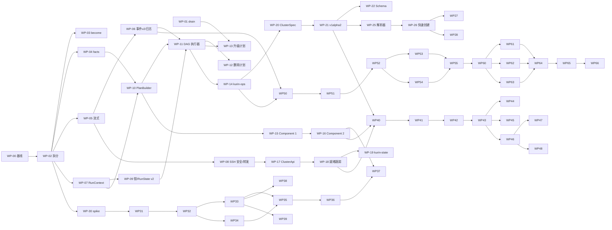

# 06 · 分阶段开发计划（给执行编码的 AI）

> 状态：定稿 v1.0 · 2026-10-27 · 代码基线 v0.4.0
> 这是**唯一的实施排期依据**。设计细节在 [01](01-landscape.md)～[05](05-cli-quick-create.md) 与 [docs/ui](../ui/ui-architecture-final.md)；本文把它们拆成可以独立交付的工作包（WP）。
> 每个 WP 都应能交给一个编码 AI 独立完成：先读“必读”，再按“步骤”做，最后用“验收”自查。

---

## 0. 执行规则（每个 WP 都适用）

### 0.1 开工前必读

1. 仓库根目录 `README.md`、`docs/plugins.md`、`docs/command-matrix.md`、`docs/v1.0-gates.md`。
2. 本 WP 引用的设计文档章节（WP 内“设计”一行给出）。
3. 本 WP 改动范围内的现有源码与测试（`kurin/tests/*.rs` 里已有 MockSession 写法，照着写）。

### 0.2 硬性规则

| # | 规则 |
|---|---|
| R1 | **一个 WP = 一个 PR**（WP 自己标明可以拆成多个 PR 的除外）。分支名 `wp-XX-<短名>`。不夹带与本 WP 无关的改动。 |
| R2 | 合入前必须通过 `just check`（fmt + clippy `-D warnings` + 全部单测）。 |
| R3 | **WP-00 的快照是行为基线。** 快照有变化时，PR 描述里要逐条说明原因；不允许整批 `cargo insta accept` 后不解释。 |
| R4 | 公开接口只增不删：CLI 参数、`--json` v1 事件字段、`v1alpha1` 配置、退出码。确有必要的行为变更写进 `CHANGELOG.md` 的 `Changed` 段。 |
| R5 | 保持既有原则：不用 `format!` 拼 YAML（用 MiniJinja 模板）；sha256/digest 必须真实来自上游；不支持的组合在**校验期**拒绝；新依赖要能在 x86_64 musl 与 aarch64 zig 下交叉编译（写进 PR 描述）。 |
| R6 | 涉及远端执行语义的 WP 要提供或更新 e2e 脚本（`e2e/tierN/*.sh`）。e2e 需要 multipass 真机环境，AI 通常无法运行：在 PR 描述里写明“需人工 e2e：`just tierX …`”，由维护者执行并在 `docs/progress.md` 记录结果。**没有 e2e 结果的执行语义改动不能发版。** |
| R7 | 新增或修改的公共函数、trait 要有 doc 注释；注释密度和风格与周边代码一致。 |
| R8 | 秘密（密码、口令、token、join 命令）不得出现在日志、事件、错误文本、快照和测试输出里；测试中使用明显的假值并断言它们被脱敏。 |
| R9 | 提交信息使用 Conventional Commits（`feat(scope): …` / `refactor(core): …`），不写模型名。 |
| R10 | 每个 WP 完成后更新相关文档：用户可见行为改 `README.md` / `docs/configuration.md` / `docs/command-matrix.md`；设计偏离本计划时，在 PR 里说明原因，并同步修改对应的设计文档。 |

### 0.3 完成定义（DoD）检查表

```text
[ ] just check 通过
[ ] 新增 / 更新的单测覆盖了 WP“测试”一栏列出的场景
[ ] WP-00 快照：无变化，或每处变化都已在 PR 中说明
[ ] CLI 输出 / --json v1 字段未被破坏（契约测试通过）
[ ] 需要 e2e 的已提供脚本，并在 PR 中写明人工执行命令
[ ] 文档已更新（README / configuration / command-matrix / CHANGELOG）
[ ] 新依赖的交叉编译情况已说明
```

### 0.4 派发模板（维护者给编码 AI 的提示词）

```text
你在 weironz/kurin 仓库实现工作包 WP-XX「<标题>」。
必读：docs/architecture/06-dev-plan.md 第 0 节与 WP-XX 全文；WP-XX“设计”一栏引用的章节；以及改动范围内的源码。
按 WP-XX 的“步骤”实现，满足“验收”的每一项，遵守第 0.2 节的硬性规则。
完成后提交到分支 wp-XX-<短名>，PR 描述包含：改动摘要、快照变化说明、交叉编译说明、需要人工执行的 e2e 命令。
遇到与设计文档冲突、或设计没有覆盖的情况：选择最保守的实现，并在 PR 中列出待决问题，不要擅自扩大范围。
```

---

## 1. 阶段总览

| 阶段 | 目标 | 工作包 | 退出条件 | 首版必需 |
|---|---|---|---|---|
| **P0** 安全网 | 锁住现有行为；修已知 bug | WP-00, 01 | 快照矩阵入库；drain bug 修复并通过 tier2 升级 e2e | 是 |
| **P1** 核心骨架 | workspace 拆分、正确性缺陷、事件与日志、DAG 执行器、一切操作皆计划、Component、ClusterApi、集群状态记录 | WP-02～19 | tier0～3 全部 e2e 通过且 CLI 输出不变；混合架构与非 root 用户 e2e 通过 | 是（WP-17/18/19 除外的部分见各 WP） |
| **P2** 配置与 CLI 快速创建 | v1alpha2、秘密引用、JSON Schema、快速参数 | WP-20～28 | 纯命令行参数创建 tier1/tier3 集群通过；v1alpha1 全部样例仍可用 | 是 |
| **P3** OCI 包 | 包格式、三种传输形态、preload/registry 分发、离线补齐、OS 依赖、签名与 SBOM | WP-30～39 | 用 OCI 包完成 tier1 离线（三种传输形态各一次）、tier3 registry 分发、rocky 离线 | WP-30～37 是；38/39 可在首版后 |
| **P4** Addon 体系 | 声明式 addon、helm 执行、就绪跟踪接入、首批目录、存储迁移 | WP-40～49 | 8 个内置 addon 在线/离线安装与卸载 e2e 通过 | WP-40～47 是 |
| **P5** Web 后端 | `kurin serve` 全部 API | WP-50～55 | API 集成测试通过；用 curl 跑通“创建 → 日志 → 状态 → 销毁” | 是 |
| **P6** Web 前端 | 页面、表单向导、日志控制台 | WP-60～66 | 浏览器完成 UI 文档的验收场景（WP-66） | 是 |
| **P7** Day-2 与生态 | etcd 备份、k3s 升级、导入、OS 扩展、CIS、conformance、种子仓库 | WP-70～78 | 各 WP 自身验收 | 否 |

### 1.1 依赖关系与并行通道



可并行的通道（满足依赖后）：

- **通道 A（引擎）**：WP-02 → 03/04/05/07 → 10 → 11 → 12/13/14
- **通道 B（传输与 K8s API）**：WP-05 → 08 → 17 → 18 → 19
- **通道 C（包）**：WP-30 → 31 → 32 → 33/34 → 35 → 36
- **通道 D（配置与 CLI）**：WP-20 → 21 → 22/25 → 26 → 27/28
- **通道 E（Web）**：WP-50 起，后端与前端可以按 API 契约（ts-rs 类型）并行；前端先对 mock 开发

---

## 2. P0 · 安全网

### WP-00 行为基线快照

- **目标**：在任何重构之前，把“计划长什么样、CLI 输出什么、`--json` 事件有哪些字段”全部固定成快照测试。
- **依赖**：无。
- **设计**：02 §4。
- **改动范围**：`kurin/Cargo.toml`（dev-dependencies 加 `insta`，开 `yaml` 或 `json` 特性）、新建 `kurin/tests/fixtures/configs/*.toml`、`kurin/tests/plan_snapshots.rs`、`kurin/tests/cli_output.rs`、`kurin/tests/event_contract.rs`、新建 `kurin/tests/support/mod.rs`（脚本化 MockSession）。
- **步骤**：
  1. 建立配置样例矩阵（每个文件都要能通过 `kurin_config::load`）：`single.toml`、`ha-kubevip-3cp.toml`、`kurin-lb.toml`、`external-endpoint.toml`、`k3s-single.toml`、`k3s-ha.toml`、`k3s-kurin-lb.toml`、`crio.toml`、`cni-flannel.toml`、`cni-cilium.toml`、`cni-kube-ovn.toml`、`cni-none.toml`、`registry-zot.toml`、`registry-docker.toml`、`registry-harbor.toml`、`storage-local-path.toml`、`storage-nfs.toml`、`offline.toml`（offline-dir 指向测试目录）、`zone-cn.toml`、`labels.toml`。
  2. `plan_snapshots.rs`：对每个样例调用 `Plan::build`，用 `kurin::render::render_tree` 输出文本快照；同时输出一个 JSON 快照：每个 stage 的任务 `id` 列表，以及每个任务的 `describe()`。
  3. `support/mod.rs` 实现 `ScriptedSession`：按“命令正则 → (exit, stdout, stderr)”的规则表应答，未匹配的命令记录下来并返回可配置的默认值；支持在第 N 次调用时注入断连错误；支持记录 `write_file` 的路径与 sha256。再实现 `ScriptedPool`。
  4. `cli_output.rs`：对 `single.toml` 用 ScriptedPool 跑 `executor::run_with`，收集 `emit` 的事件，以当前 `main.rs` 的格式渲染成文本快照（`skip/done/ok/FAIL/-- stage`）；同时对 `event_json_line` 的输出做快照。
  5. `event_contract.rs`：对 `Event` 的每个变体断言 JSON 字段集合，作为 `docs/v1.0-gates.md` §2 的契约测试。
  6. 在 `justfile` 增加 `snapshots-review`：`cargo insta review`。
- **测试**：本身就是测试。
- **验收**：`just check` 通过；快照文件入库（`kurin/tests/snapshots/`）；故意改动 `plan.rs` 中某个任务的阶段时，快照测试会失败（在 PR 描述里说明你做过这个验证）。
- **注意**：只加测试，不改生产代码。如果某个样例因为现有校验无法加载，就从矩阵里去掉，并在 PR 中列出原因。

### WP-01 修复 upgrade 的 drain 判定

- **目标**：drain 失败时必须中止该节点的升级。
- **依赖**：无（可与 WP-00 并行）。
- **设计**：02 §2.2 P6。
- **改动范围**：`kurin/src/upgrade.rs`（`upgrade_one_node`，约 394-410 行）、`kurin/src/main.rs`（新增参数）、测试。
- **步骤**：
  1. 去掉 drain 命令末尾的 `; true`，用真实的退出码判断成败；`drain_ok = exit_code == 0`。
  2. 失败时返回错误：`drain <node> failed: <stderr 或 stdout 的第一行>`；不 uncordon，不继续下一个节点或批次。
  3. 新增 `kurin upgrade --force-drain-failure`（默认关闭）：开启后保留旧行为（告警并继续），并在输出中明确标注。
  4. 不要改 `teardown.rs` 中的 `; true`（那里是有意的“尽力清理”，WP-12 会把它改成显式策略）。
- **测试**：ScriptedSession 让 drain 返回 exit 1，断言 `upgrade` 返回错误，且之后没有执行任何 `install`/`kubeadm upgrade` 命令；`--force-drain-failure` 时继续执行。
- **验收**：`just check`；需人工 e2e：`just tier2-upgrade-minor`。
- **注意**：CHANGELOG `Fixed` 段写明行为变化。

---

## 3. P1 · 核心骨架

### WP-02 workspace 拆分（纯移动）

- **目标**：按 02 §3.1 拆分 crate，**不改任何行为**。
- **依赖**：WP-00。
- **设计**：02 §3.1。
- **步骤**：
  1. 新建 `crates/`，把 `kurin-config` 移到 `crates/kurin-config`。
  2. 从 `kurin` 中拆出：`crates/kurin-core`（`engine.rs`、`executor.rs`、`plan.rs` 的数据结构、`render.rs`、`state.rs`）、`crates/kurin-ssh`（`ssh.rs`）、`crates/kurin-artifact`（`artifact.rs`、`artifact_bundle.rs`、`dynamic_manifest.rs`、`zone.rs`、`version.rs`、`artifacts/manifest.json`）、`crates/kurin-components`（`tasks/`、`templates.rs`、`templates/`、`certs.rs`、`precheck.rs`、`status.rs`、`teardown.rs`、`upgrade.rs`，以及 `plan.rs` 中的 `build_with_pool` 构建逻辑）。`kurin-kube`、`kurin-ops`、`kurin-server` 先建空 crate（含 `lib.rs` 与一行 doc 注释）。
  3. `kurin/` 只保留 `main.rs` 与 `examples/`；为了让既有测试少改，可以在 bin 包里保留一个 `kurin` lib 作为 facade，`pub use` 各 crate（这一步按实际情况决定：如果保留 facade，就把 `kurin/tests/` 原样留着；否则把测试迁到对应 crate）。
  4. 处理循环依赖：`plan.rs` 的数据结构（`Plan`、`StageNode`）放进 core，构建函数放进 components；`executor` 只依赖 core。
  5. 根 `Cargo.toml` 设置 `[workspace.dependencies]`，统一版本。
  6. `justfile` 中 `-p kurin` 保持可用；`release-musl` 产物路径不变。
- **测试**：所有既有测试与 WP-00 快照无变化。
- **验收**：`just check`；`just build`；`just release-musl` 能生成两个架构的产物（如果本机没有 zig 交叉环境，在 PR 中说明需人工执行）；`git diff --stat` 中应主要是 rename。
- **注意**：用 `git mv` 保留历史；可以拆成 2～3 个 PR（先 config，再 core/ssh/artifact，最后 components）。

### WP-03 提权（become / sudo）

- **目标**：非 root SSH 用户可以完成全部操作。
- **依赖**：WP-02。
- **设计**：02 §3.5。
- **改动范围**：`kurin-config`（`[ssh] become`、`become-password`，节点级可覆盖）、`kurin-core`（`Cmd` 结构、`Session` trait 签名）、`kurin-ssh`、全部任务中的 `exec` 调用点。
- **步骤**：
  1. 在 `kurin-core::engine` 引入 `Cmd { script, privileged, mutating, timeout, redact }`，提供 `Cmd::new(s)`（默认 `privileged = true, mutating = true`）、`Cmd::probe(s)`（`privileged = true, mutating = false`）、`.unprivileged()`。
  2. `Session::exec(&self, cmd: &Cmd)`；为了平滑迁移，暂时提供 `exec_str(&self, &str)` 默认实现（等价于 `Cmd::new`），后续 WP 再逐步改成显式的 `Cmd`。
  3. `kurin-ssh`：登录用户不是 root 且 `privileged` 时，用 `sudo -n -- sh -c '<转义后的 script>'` 包装；配置了 become 密码时用 `sudo -S -p '' -- sh -c …`，经 stdin 写入密码。`write_file`：先写 `/tmp/kurin-<uuid>`，再 `sudo install -D -m <mode> <tmp> <dst> && rm -f <tmp>`。
  4. 配置：`[ssh] become = "auto" | "sudo" | "none"`（默认 auto：非 root 时用 sudo），`become-password` 接受字面值（v1alpha1）；秘密引用在 WP-20 加入。
  5. 把 `/etc/kurin/*`、`/usr/local/bin/*` 等系统路径的写入都纳入特权路径。
  6. precheck：`sudo` 检查项改为“`become = none` 且非 root 时 fail”。
- **测试**：ScriptedSession 断言非 root 时命令被包装、root 时不包装；单引号转义（脚本中含 `'`）的单测；become 密码不出现在任何事件/错误文本中。
- **验收**：`just check`；新增 `e2e/tier1/nonroot.sh`（multipass 中创建 `ubuntu` 用户 + 免密 sudo，`ssh.user = "ubuntu"`，完成单节点安装与删除），需人工执行。
- **注意**：k3s 的 `install.sh` 风格命令、`kubectl --kubeconfig /etc/kubernetes/admin.conf` 都需要特权；只有 `uname`、`cat /etc/os-release` 这类探测可以不提权。

### WP-04 节点 facts 与按节点架构选择制品

- **目标**：新增 discover 阶段；制品按节点架构选择；支持混合架构。
- **依赖**：WP-02（WP-03 合入后，facts 中的 sudo 能力才有意义；两者可并行，先合入的一方负责 rebase）。
- **设计**：02 §3.4。
- **改动范围**：`kurin-core::facts`（类型）、`kurin-components::discover`（采集任务与解析）、`plan` 构建、`tasks/install.rs`、`tasks/images.rs`、`cni/calico.rs`、`cni/flannel.rs`、`cri_o.rs`、`upgrade.rs`、`main.rs` 中所有 `std::env::consts::ARCH` 用法、`precheck.rs`。
- **步骤**：
  1. 定义 `NodeFacts` 与 `FactsTable`（`HashMap<String, NodeFacts>`）。
  2. 写一段只读 shell 脚本，一次输出 `key\tvalue` 行：`uname -m`、`/etc/os-release` 的 ID/VERSION_ID/ID_LIKE、`uname -r`、cgroup v2（`stat -fc %T /sys/fs/cgroup`）、`nproc`、`MemTotal`、`df -Pm / /var/lib`、`hostname`、`id -u`、`sudo -n true`、`sshd -T | grep allowtcpforwarding`（失败时为未知）、已安装组件的版本（`kubelet --version`、`k3s --version`、`containerd --version`，不存在时为空）、`test -f /etc/kubernetes/admin.conf`。
  3. 执行入口：`discover(pool, cluster) -> Result<FactsTable>`，节点之间并行；单节点失败时整体失败，并列出所有失败节点。
  4. `create/add nodes/upgrade/delete`：先 discover，再构建计划；`Plan::build_with_pool` 接收 `&FactsTable`。没有 facts 时（离线 `--dry-run`），用配置中新增的可选字段 `nodes.<n>.arch`，否则按控制机架构，并在计划头部打印“架构未探测”的提示。
  5. 把 `ArtifactsInstall`、`ImagesImport`、各 CNI 的架构参数改为取 `facts[node].arch`。
  6. precheck 改为基于 facts 输出（保持行与 JSON 格式不变，WP-00 快照守护）。
  7. `kurin artifact`（以及后续的包）对混合架构集群要包含所有涉及的架构。
- **测试**：ScriptedSession 返回 `aarch64` 时，计划中的制品是 arm64；混合架构样例的计划快照；os-release 解析单测（ubuntu、debian、rocky、openEuler 样本）。
- **验收**：`just check`；需人工 e2e：现有 tier1/tier2 不回归；新增 `e2e/tier1/mixed-arch.md`，说明在 Apple Silicon 主机或 qemu 上准备 arm64 节点、在 x86 控制机上部署的手工步骤。
- **注意**：`--dry-run`（无 SSH）必须继续零网络；新增的 discover 阶段在计划树里显示为第一阶段，WP-00 快照会变化，需在 PR 中说明。

### WP-05 流式 exec 与流式上传

- **目标**：远端输出逐行可见；上传不再整文件读入内存。
- **依赖**：WP-02。
- **设计**：02 §3.5。
- **改动范围**：`kurin-core::engine::Session`、`kurin-ssh`、`tasks/install.rs`、`tasks/images.rs`、`registry.rs`（大文件上传处）、所有 MockSession 实现。
- **步骤**：
  1. `exec_stream(&self, cmd, sink: &mut (dyn FnMut(Stream, &str) + Send))`：russh channel 读到 `Data`/`ExtendedData(1)` 时按 `\n` 切行，回调 sink；剩余的半行在 EOF 时冲刷；同时累计完整输出，作为返回值。
  2. 行长度上限 8 KiB（超出截断并标注 `…[truncated]`），总输出累计上限 16 MiB（超出后只保留最后 1 MiB）。
  3. `upload(src: UploadSource, dst, mode) -> UploadReport { bytes, sha256, ms }`：`UploadSource::File` 以 64 KiB 分块读取并写入 channel，边写边算 sha256，结束后在远端执行 `sha256sum` 比对，不一致则报错；临时文件加 rename，保持现有的“写临时名再 mv -f”规则。
  4. `write_file` 保留，作为 `upload(Bytes)` 的便捷包装。
  5. `ArtifactsInstall` 改用 `upload(File)`。
  6. 给 `Session` 提供 `exec_stream` 的默认实现（调用 `exec` 后一次性回调全部行），这样测试中的 Mock 不必全部重写。
- **测试**：切行逻辑单测（跨块断行、CRLF、无结尾换行、超长行）；上传 sha256 不一致时报错；内存上限单测（用 1 GiB 的稀疏文件，只在 `--ignored` 测试中运行）。
- **验收**：`just check`；需人工 e2e：`just tier1-offline`（最大的上传路径）不回归，并在 PR 中记录上传期间控制机的 RSS 峰值。
- **注意**：先不接事件系统，由 WP-06 把行接到日志。

### WP-06 事件 v2、tracing 与操作日志

- **目标**：所有事件带时间戳与序号；任务日志与远端输出进入统一事件流；每次操作都写 JSONL 日志；新增 `kurin logs`。
- **依赖**：WP-05。
- **设计**：02 §3.10；UI 文档 §8.5。
- **改动范围**：`kurin-core::events`（新）、`executor.rs`、`render.rs`、`main.rs`、各任务里的 `eprintln!`、`upgrade.rs`/`teardown.rs`/`certs.rs` 的 `report()`。
- **步骤**：
  1. 实现 `Envelope`/`Body`（02 §3.10）与 `EventBus`：`publish(Body)` 自动分配 `seq` 和 `ts`（`time` 或 `jiff` crate，选一个并写明理由），`subscribe() -> Receiver`（有界）；同步写入的订阅者（JSONL 写入器、终端渲染器）通过 trait `EventSink` 注册。
  2. `tracing` + 自定义 `Layer`：把 span 中的 `op/phase/task/node` 字段与事件消息转成 `Body::Log`。
  3. `TaskCtx`（本 WP 先做最小版本：`log` 句柄）或者给 `Task::apply` 传入日志句柄的过渡方案：任务里的 `eprintln!` 全部改为 `tracing`；`exec_stream` 的输出行以 `Log{stream: Stdout|Stderr, level: Debug}` 发布。
  4. 执行器：`TaskStart/Done/...` 走 `EventBus`；旧的 `emit: FnMut(Event)` 由适配器从 bus 订阅后转换，保证 `--json` v1 输出不变，只**新增 `ts` 字段**。
  5. `upgrade.rs`/`teardown.rs`/`certs.rs` 中的 `report(node, step, ok, detail)` 改为发布 `Body::Log`（info/warn），终端渲染器保持原文本格式输出（WP-12/13 再改成任务）。
  6. JSONL 写入器：`$XDG_STATE_HOME/kurin/logs/<cluster>/<op-id>.jsonl`（回退到 `~/.local/state`）；操作开始时打印一次日志路径（stderr）。
  7. 脱敏：`RunContext`（或本 WP 的临时结构）持有秘密值集合，发布前统一替换为 `******`。
  8. CLI：全局参数 `--timestamps`、`-v`（显示 info 级远端输出摘要）、`-vv`（全部 stdout/stderr）、`--json=v2`；新命令 `kurin logs [--cluster C] [--op ID|--last] [--follow] [--node N] [--level L] [--json]`。
- **测试**：`seq` 单调递增；v1 JSON 契约测试只多出 `ts`；脱敏测试；`kurin logs` 对样例 JSONL 的过滤；终端输出快照（默认模式不变，`--timestamps` 模式新快照）。
- **验收**：`just check`；人工：tier1 安装后 `kurin logs --last -vv` 能看到 kubeadm init 的完整输出和时间戳。
- **注意**：默认终端输出必须与 WP-00 快照一致。

### WP-07 RunContext 与 Blackboard

- **目标**：去掉 `OnceLock` 全局状态；跨任务数据改走 Blackboard。
- **依赖**：WP-02。
- **设计**：02 §3.3。
- **改动范围**：`kurin-artifact`（删除 `set_zone`/`zone()`/`set_manifest_override`/`install_manifest()` 的全局版本）、所有调用点（约 12 处）、`tasks/bootstrap.rs` 的 join 材料、`tasks/k3s.rs` 的 token、`main.rs`。
- **步骤**：
  1. 在 `kurin-core` 定义 `RunContext`（字段见 02 §3.3；本 WP 只需要 `op_id`、`cluster`、`zone`、`sources`、`cancel`、`bb`、`events`（WP-06 未合入时先放占位））与 `Blackboard`/`Key<T>`。
  2. `Plan::build*` 与 `executor::run_with` 接收 `&Arc<RunContext>`；任务在构造时保存需要的 `Arc<RunContext>` 引用，或在 `apply` 时通过参数获得（与 WP-06 的 `TaskCtx` 合并成 `TaskCtx { run, node, ... }`，谁后合入谁负责整合）。
  3. join 材料与 k3s token 改为写入 Blackboard（`Persist::RunStateSecret`），读取方从 Blackboard 取；为保持 `--resume` 可用，RunState 序列化需要持久化的 key（WP-09 完成正式格式，本 WP 可先写入 `runs/<cluster>.bb.json`，权限 0600）。
  4. 删除 `~/.cache/kurin/clusters/<name>` 的读写；`delete cluster` 里对它的清理保留一个版本（兼容旧目录）。
- **测试**：单进程并行构建两个不同 zone 的计划，断言镜像地址不同；join 材料在 Blackboard 中传递的单测；`--resume` 能取回 join 材料。
- **验收**：`just check`；`rg 'OnceLock' crates/` 只剩与运行上下文无关的用法；人工 e2e：`just tier2`、`just tier1-zone`、`just tier1-k3s`。

### WP-08 SSH 安全与端口转发

- **目标**：变更命令断连时不再透明重试；主机密钥策略可配；提供端口转发 API。
- **依赖**：WP-05。
- **设计**：02 §3.5、§3.11。
- **改动范围**：`kurin-ssh`、`kurin-config`（`[ssh] known-hosts`）。
- **步骤**：
  1. `with_channel` 的重试只用于 `Cmd.mutating = false` 的命令和文件 sha 探测；变更命令断连时返回 `SshError::TransportLost`。
  2. 引擎把 `TransportLost` 映射为 `Outcome::Unknown`（保持现有“重新探测”语义；在执行器中统一处理，不要求每个任务自己处理）。
  3. `known-hosts = "tofu" | "strict" | "accept-new"`：strict 时未记录的主机直接拒绝；accept-new 等同于 tofu，但不提示；三者遇到不匹配的主机密钥都拒绝。
  4. `forward_local(remote_addr) -> LocalForward { local_addr }`：在控制机 `127.0.0.1:0` 上监听，每个入站连接开一个 `direct-tcpip` channel；`Drop` 时关闭监听。
  5. `forward_remote(local_addr) -> RemoteForward { remote_port }`：`tcpip_forward` 请求加转发回调（为 WP-77 预留，本 WP 只需单测）。
- **测试**：用 ScriptedSession 模拟断连，验证变更命令不重试、只读命令重试一次；端口转发用 tier0 的 systemd 容器做集成测试（`kurin/tests/ssh_docker.rs` 已有类似模式）。
- **验收**：`just check`；`just tier0 tier0-test`。

### WP-09 集群锁与 RunState v2

- **目标**：CLI 的变更操作互斥；续跑状态带计划指纹与 Blackboard。
- **依赖**：WP-07。
- **设计**：02 §3.13；UI 文档 §6.5。
- **步骤**：
  1. `ClusterLock::acquire(cluster) -> Result<ClusterLockGuard>`：`$XDG_STATE_HOME/kurin/locks/<cluster>.lock`，`File::try_lock`（MSRV 不满足 1.89 时用 `fs4`）；锁文件内写入 pid、op_id、命令行、开始时间，冲突时的错误信息里带上这些内容。
  2. `create cluster`、`add nodes`、`delete node`、`delete cluster`、`upgrade`、`certs renew` 获取锁；只读命令不加锁。
  3. RunState v2：`{ version: 2, cluster, op_id, plan_fingerprint, done: [...], blackboard: {...} }`，文件权限 0600；读取 v1 文件时兼容（视为无指纹）。
  4. `--resume`：指纹不一致时报错，提示“计划已变化，请去掉 --resume 重新运行（已收敛的任务会被检查跳过）”。
- **测试**：两个进程抢锁（集成测试用 `std::process::Command` 启动自身测试二进制）；v1 状态文件兼容；指纹不一致时拒绝。
- **验收**：`just check`；人工：两个终端同时对 tier1 执行 `add nodes`，第二个立即失败并显示第一个的 pid 与命令。

### WP-10 PlanBuilder、NodeSel 与 Phase 模板

- **目标**：用 PlanBuilder 重写计划构建，消灭魔法下标和重复过滤；create 计划与现在**完全等价**（只多出 WP-04 的 discover）。
- **依赖**：WP-04、WP-07。
- **设计**：02 §3.6。
- **步骤**：
  1. 在 core 中实现 `Phase`、`PlanBuilder`（`phase()`、`add()`、`after()`、`rolling()`）、`NodeSel`（`k8s()`、`control_plane()`、`first_cp()`、`workers()`、`role()`、`by_name()`）、`OpKind` 与每个操作的 phase 模板常量。
  2. `Plan` 内部改为任务列表 + 边；保留 `stages()` 访问器，供现有渲染与执行器使用（WP-11 之前，执行器仍然按 phase 顺序执行）。
  3. 把 `plan.rs` 的构建逻辑改写为一组 `fn plan_<area>(b: &mut PlanBuilder)`（os、runtime、registry、images、ha、bootstrap、join、cni、storage、post），k3s 分支同样拆成这些函数里的发行版判断（WP-15 再变成 Component）。
  4. `render_tree` 改为基于新结构，输出与以前一致。
- **测试**：WP-00 快照除 discover 外**零变化**。
- **验收**：`just check`。

### WP-11 DAG 执行器

- **目标**：执行器按依赖图调度，支持并发上限、rolling、BestEffort、取消、计划指纹。
- **依赖**：WP-06、WP-09、WP-10。
- **设计**：02 §3.6。
- **步骤**：
  1. 调度器：入度表 + 就绪队列；`RunSettings { max_parallel: 32, per_node: 4 }`（per-node 取 SSH channel 数）；同 phase 屏障由 PlanBuilder 生成为普通边，执行器只看边。
  2. 失败处理：任务失败后，标记所有（传递）后继为 `Blocked`，不再调度；在途任务完成后，返回第一个错误，并发出每个被阻塞任务的 `TaskSkipped { reason: "blocked by <key>" }`（新增可选字段）。
  3. `FailurePolicy::BestEffort`：失败时发 `TaskWarn`，后继照常执行。
  4. `rolling(group, n)`：组内任务按顺序分批，每批最多 n 个，一批全部完成后再开始下一批；任一失败即停止该组。
  5. 取消：每次出队前检查 `cancel`；取消后不再调度新任务，等待在途任务完成，返回 `Cancelled` 错误；`OpFinished{result: cancelled}`。
  6. 计划指纹：`sha256(按拓扑序排列的 key + describe)`，写入 `OpStarted` 与 RunState。
  7. `Unknown` 结果的“重新探测”逻辑原样保留。
- **测试**：单测覆盖拓扑执行顺序、并发上限、失败阻塞传播、BestEffort、rolling 批次顺序、取消（在第 k 个任务后触发）、per-node 上限；WP-00 快照与 CLI 输出快照不变。
- **验收**：`just check`；人工 e2e：tier1、tier2、tier3 全部通过（执行器是最高风险的改动）。

### WP-12 删除节点 / 删除集群改为计划

- **目标**：`delete node`、`delete cluster` 走计划与执行器；“尽力清理”显式化。
- **依赖**：WP-11。
- **设计**：02 §3.7。
- **步骤**：
  1. 把 `teardown.rs` 中的每个步骤拆成任务：`drain`、`delete-node-object`、`kubeadm-reset` / `k3s-uninstall`、`stop-services`、`wipe-dirs`、`cni-cleanup`、`iptables-cleanup`、`local-state-cleanup`。`check` 实现收敛判断（例如目录不存在即 InSync）。
  2. 原来 `; true` 的步骤改为 `FailurePolicy::BestEffort`，失败时发 `TaskWarn` 并在最终汇总中逐节点列出。
  3. 顺序：delete-cluster 中 workers 先、control-plane 后（用依赖边表达）；delete-node 中 API 侧步骤在锚点控制面执行（锚点不可达时跳过并告警，与现有行为一致）。
  4. 支持 `--dry-run [--check]`。
  5. 终端输出：渲染器把这些任务的事件渲染成接近现有 `[node] ✓ step` 的格式；格式变化在 PR 中说明，并更新 CLI 快照。
- **测试**：计划快照（delete-node / delete-cluster × kubeadm/k3s）；BestEffort 汇总；锚点不可达。
- **验收**：`just check`；人工 e2e：`just tier1-k3s`（含 delete）、`e2e/tier1/k3s-delete.sh`、tier2 删除 worker、tier3 删除集群。

### WP-13 升级改为计划

- **目标**：`upgrade` 走计划与执行器，支持 rolling、dry-run、resume。
- **依赖**：WP-11、WP-01。
- **设计**：02 §3.6、§3.7。
- **步骤**：
  1. 每节点的任务链：`version-check`（已是目标版本则 InSync）→ `cordon` → `drain` → `install-bins` → `kubeadm-upgrade`（首个控制面执行 `apply`，其余执行 `node`）→ `restart-kubelet` → `ready-gate` → `uncordon`。
  2. 首个控制面单独一组；其余控制面 `rolling(1)`；workers `rolling(--batch)`。
  3. 离线升级（`--offline`）复用同一计划，只是制品来源不同（`RunContext.sources`）。
  4. `upgrade --dry-run` 输出计划树（替代现在的 `upgrade::plan` 打印）；保留现在 dry-run 输出中的“当前 → 目标”版本表头。
  5. 删除 `upgrade.rs` 中的命令式循环与 `report()`。
- **测试**：计划快照（1CP+1W、3CP+3W、batch=2）；drain 失败阻塞后续节点（WP-01 的语义保持）；已升级节点 InSync。
- **验收**：`just check`；人工 e2e：`just tier2-upgrade-minor`、`e2e/tier2/upgrade-offline.sh`。

### WP-14 kurin-ops：操作层与 certs/status/precheck

- **目标**：`main.rs` 只剩参数解析；所有操作在 `kurin-ops` 中实现；`certs renew` 改为计划；`status`/`precheck`/`certs check` 返回结构化数据。
- **依赖**：WP-11。
- **设计**：02 §3.2；UI 文档 §6.1（以 02 为准）。
- **步骤**：
  1. `kurin-ops` 公共 API：`OpRequest { kind, spec, params }`、`prepare(req) -> Prepared { run: Arc<RunContext>, lock, facts }`、`plan(prepared) -> Plan`、`execute(prepared, plan) -> OpResult`；以及只读函数 `status()`、`precheck()`、`certs_check()`、`plan_view()`。
  2. 把 `main.rs` 中 `add_nodes` 的“探测运行中版本 → 动态 manifest → 刷新 join 材料”逻辑移入 `kurin-ops::add_nodes::prepare`（WP-19 合入后改为读 kurin-state）。
  3. `create cluster` 的 HA 告警改为 `Body::Log(warn)`，终端输出不变。
  4. `certs renew`：每个控制面节点 `renew → restart-static-pods → apiready-gate`，`rolling(1)`。
  5. `StatusReport` 派生 `Serialize`；`status --json` 改为直接序列化（字段保持不变，快照守护）；`status` 拆分为核心与证书两部分（`StatusOpts { certs: bool }`），首个控制面不可达时依次尝试其他控制面。
  6. `PlanView` DTO（`Serialize`）：phases → tasks（key、node、describe、drift）。
- **测试**：CLI 输出快照不变；`PlanView` 快照；status 多控制面回退单测。
- **验收**：`just check`；`kurin/src/main.rs` 中不再出现 `executor::`、`Plan::` 的直接调用；人工 e2e：`just tier2-certs`、`just tier2-status`、`just tier1-k3s-ops`。

### WP-15 Component trait（一）：os、runtime、distro

- **目标**：引入 Component 与注册表，迁移 os/runtime/distro。
- **依赖**：WP-10。
- **设计**：02 §3.8；03 §3。
- **步骤**：
  1. 在 `kurin-components` 定义 `Component` trait、`ComponentKind`、`Capabilities`、`ArtifactRef`、`ComponentRegistry`。
  2. 实现并注册：`os/baseline`、`os/sysctl`、`os/kernel-deps`、`runtime/containerd`、`runtime/crio`、`distro/kubeadm`、`distro/k3s`。每个组件的 `plan()` 接管 WP-10 拆出来的对应 `plan_<area>` 函数。
  3. 构建入口变为“遍历注册表中 `enabled` 的组件调用 `plan()`”；尚未迁移的区域（ha/cni/registry/storage/post）暂时保留函数调用。
  4. `validate()`：把 `kurin-config/src/model.rs::validate` 中与这些组件相关的规则搬过来（错误文本保持不变，诊断快照守护）；`kurin-config` 中保留纯结构类校验。
- **测试**：WP-00 快照零变化；每个组件的 validate 单测。
- **验收**：`just check`。

### WP-16 Component trait（二）：ha、cni、registry、storage 与能力表

- **目标**：完成全部内置组件的迁移；能力表成为单一事实来源。
- **依赖**：WP-15。
- **步骤**：
  1. 迁移 `ha/kube-vip`、`ha/kurin-lb`、`ha/external`、`cni/*`、`registry/*`、`storage/*`（storage 在 WP-47 改为 addon，这里先作为第 1 层组件迁移）、`post/*`（kubeconfig、summary、labels）。
  2. `capabilities()` 汇总生成：`kurin capabilities --json`（新的隐藏子命令，供 Web 与文档生成使用）；`just docs-matrix` 从它生成 `docs/command-matrix.md` 中的“create cluster”表（保留人工维护的“e2e 验证”列，生成器只负责“支持 / 拒绝”）。
  3. `artifacts(spec, arch)`：每个组件声明自己的制品（二进制、镜像、manifest）；`kurin artifact` 改为从注册表汇总（为 P3 打基础），离线镜像集合不再手工维护。
- **测试**：快照零变化；能力表快照；`artifacts()` 汇总与现有 bundle 内容一致（以 WP-00 时的 `kurin artifact` 产物文件列表作为对照快照）。
- **验收**：`just check`；人工 e2e：`just tier1-offline`、`just tier3-external-lb`。

### WP-17 ClusterApi（kubectl 后端 + 隧道 kube-rs 后端）

- **目标**：提供统一的 K8s API 访问接口。
- **依赖**：WP-08。
- **设计**：02 §3.11。
- **步骤**：
  1. 在 `kurin-kube` 定义 `ClusterApi` trait 与 `ObjRef`、`ApplyOpts`、`DeleteOpts`、`ApplyReport`。
  2. `KubectlApi`：在锚点节点执行 `kubectl`（kubeadm：`kubectl --kubeconfig /etc/kubernetes/admin.conf`；k3s：`k3s kubectl`），`apply --server-side --field-manager=kurin -f -`（stdin 传入 YAML），`get -o json`；锚点失败时依次尝试其他控制面。
  3. `TunnelApi`：`forward_local(127.0.0.1:6443)` + 从锚点读取 admin kubeconfig（内存中改写 server 为本地转发地址，设置 `tls-server-name: kubernetes`）→ `kube::Client`；用 `kube::api::DynamicObject` + `Discovery` 做服务端 apply。
  4. 选择逻辑：`facts.tcp_forwarding != Some(false)` 时用 TunnelApi，失败自动回退 KubectlApi，并发出一条 info 日志。
  5. 把 `status.rs`、`tasks/post.rs::NodeLabels`、`storage.rs` 中的 kubectl 文本调用改用 `ClusterApi`（CNI 留到 WP-48）。
  6. 记录二进制体积变化（`just build` 前后的 `ls -l`），写进 PR。
- **测试**：KubectlApi 用 ScriptedSession 测试命令拼装；TunnelApi 的集成测试放在 `#[ignore]`，用 tier1 环境手动运行（`KURIN_IT_CLUSTER=…`）。
- **验收**：`just check`；人工 e2e：`just tier2-status`、`just tier1` 标签任务。
- **注意**：k8s-openapi 只开一个版本特性（例如 `v1_33`），在 PR 中说明如何随支持的 K8s 版本更新。

### WP-18 资源就绪跟踪器

- **目标**：nelm 式的就绪跟踪，以及“卡住时的自动诊断”。
- **依赖**：WP-17、WP-06。
- **设计**：02 §3.11；03 §4.5。
- **步骤**：
  1. `track(refs, TrackOpts { timeout, interval: 2s }, bus)`：内建规则覆盖 Deployment（`updatedReplicas == replicas && availableReplicas == replicas && observedGeneration >= generation`）、StatefulSet、DaemonSet（`numberReady == desiredNumberScheduled`）、Job（`succeeded >= completions`）、Pod、PVC（Bound）、CRD（Established）、APIService（Available）、Node（Ready）；未知类型按 `status.conditions[type=Ready|Available]`。
  2. 每个周期发布 `Resource` 事件（只在状态变化时发布，外加每 30 秒一次心跳）。
  3. 超时或检测到失败状态（`CrashLoopBackOff`、`ImagePullBackOff`、`ErrImagePull`、Job 失败）时：列出相关 Pod 的最近 20 条 Event，并抓取问题容器最后 50 行日志，以 `Log{level: warn}` 发布；然后返回错误，错误文本给出最可能的原因（例如“镜像拉取失败：registry.k8s.io/… — 检查仓库 mirror 配置”）。
  4. 首个使用者：CNI 就绪（替换现有的轮询逻辑，保持判定语义）与 storage。
- **测试**：用 JSON fixture 测试每种规则；诊断文本快照。
- **验收**：`just check`；人工：tier1 中故意配置错误的镜像地址，确认日志里出现事件与容器日志，并给出原因提示。

### WP-19 集群内状态记录 kurin-state

- **目标**：集群自己记住装了什么。
- **依赖**：WP-17、WP-14。
- **设计**：02 §3.9。
- **步骤**：
  1. `post` 阶段新增 `StateRecord` 任务：服务端 apply `kube-system/ConfigMap kurin-state`（字段见 02 §3.9；`spec.toml` 必须经过脱敏，并有单测断言不含任何秘密）。
  2. `kurin-ops` 提供 `read_state(api) -> Option<ClusterStateRecord>`。
  3. `add nodes` 优先读记录获取运行中的版本，读不到时回退现有探测。
  4. `status` 输出“期望（记录） vs 观测”的版本差异。
  5. `delete cluster` 不需要处理（集群已销毁）。
- **测试**：记录序列化快照；脱敏单测；记录缺失时的回退。
- **验收**：`just check`；人工 e2e：tier2 安装后 `kubectl -n kube-system get cm kurin-state -o yaml` 内容正确；`add nodes` 走记录路径。

---

## 4. P2 · 配置 v1alpha2 与 CLI 快速创建

### WP-20 ClusterSpec 与秘密引用

- **目标**：内部模型改为 `ClusterSpec`；秘密字段支持 `{ env }` / `{ file }`；全局脱敏表。
- **依赖**：WP-14。
- **设计**：02 §3.12。
- **步骤**：
  1. `kurin-config`：新增 `SecretRef`（untagged：字符串 | `{ env = "…" }` | `{ file = "…" }`），`resolve() -> Result<SecretString>`（`secrecy` crate）；file 权限宽于 0600 时告警。
  2. 用 `ClusterSpec`（02 §3.12）取代平铺的 `Cluster`；提供 `From<v1alpha1::ClusterConfig>`；组件的配置段（registry、storage、cni 专属参数）进入各自的子结构。
  3. 所有秘密字段（`ssh.auth.password`、`passphrase`、`become-password`、`registry.password`，以及节点级覆盖）都改为 `SecretRef`；`Debug` 打码；`source` 字段 `#[serde(skip)]`。
  4. `kurin-ops::prepare` 解析全部秘密，并注册到 `RunContext` 的脱敏表。
  5. 全仓库调用点迁移（机械性改动）。
- **测试**：SecretRef 三种形态的解析；缺失环境变量时的诊断；Debug 输出不含秘密；全部 WP-00 快照与诊断快照不变。
- **验收**：`just check`。

### WP-21 v1alpha2 schema 与迁移命令

- **目标**：新增 `version = "v1alpha2"`，v1alpha1 继续可用；提供迁移命令。
- **依赖**：WP-20。
- **设计**：02 §3.12；03 §4.3；04 §4；05 §5。
- **步骤**：
  1. v1alpha2 的结构变化：`[runtime] kind`（取代 `kubernetes.runtime` 一类的位置，以实际 v1alpha1 字段为准）、`kubernetes.distribution = "kubeadm" | "k3s"`（`k8s` 作为别名）、`[packages]`、`[addons.<name>]`（WP-40 填充具体内容，本 WP 先定义为 `enabled/version/source/values/raw-values`，未知 addon 名在校验期报错）、`[storage]` 移除（由 `addons.local-path`/`addons.nfs-subdir` 取代）、`[ssh] become/known-hosts`、`[registry] kind = "external"` 预留。
  2. 加载器按 `version` 分派；两种版本都转换为 `ClusterSpec`。
  3. `kurin config migrate -f old.toml [-o new.toml]`：用 toml_edit 保留注释与顺序；无法自动迁移的字段报错并给出人工步骤。
  4. `kurin create config` 默认输出 v1alpha2，`--schema-version v1alpha1` 输出旧版。
  5. 更新 `docs/configuration.md`（两个版本的对照表）。
- **测试**：所有 v1alpha1 样例迁移后的快照；迁移后加载得到的 `ClusterSpec` 与直接加载 v1alpha1 的结果相等（属性测试或逐样例断言）；注释保留。
- **验收**：`just check`；`kurin-config/tests/snapshots.rs` 中的历史样例全部继续通过（v1.0 门禁 §1）。

### WP-22 JSON Schema 导出

- **目标**：配置 schema 机器可读，供 Web 表单和外部工具使用。
- **依赖**：WP-21。
- **步骤**：`schemars` 派生到 v1alpha2 的全部配置类型；文档注释成为 `description`；`kurin config schema [--version v1alpha2]` 输出 JSON Schema；CI 检查 `docs/schema/cluster.v1alpha2.json` 与生成结果一致。
- **测试**：schema 快照；用 `jsonschema` crate（dev-dependency）校验所有样例配置都满足 schema。
- **验收**：`just check`。

### WP-25 节点参数解析器

- **目标**：IP 范围、`--node` KV 语法、批量文本的解析，CLI 与 Web 共用。
- **依赖**：WP-21。
- **设计**：05 §3.1。
- **改动范围**：`kurin-config::quick::{iprange, nodespec, bulk}`。
- **步骤**：
  1. `parse_ips("192.168.10.11-13,192.168.10.20") -> Vec<Ipv4Addr>`：支持末段范围、完整范围、逗号列表；上限 512；IPv6 返回明确的“不支持”错误。
  2. `parse_node_kv("name=…,address=…,role=…,labels=a=b;c=d")`。
  3. `parse_bulk(text)`：每行 `IP[,IP…][ 空白 角色][ 空白 名称]`，`#` 开头为注释（供 Web 批量粘贴）。
  4. 自动命名：`role-index` 策略（`cp-1`、`worker-1`、`lb-1`、`registry-1`），与已有名称冲突时顺延。
- **测试**：大量表驱动单测（合法与非法输入、诊断文本）。
- **验收**：`just check`。

### WP-26 快速创建参数

- **目标**：`create cluster` / `create config` 支持完整的快速参数。
- **依赖**：WP-25、WP-03、WP-04。
- **设计**：05 全文。
- **步骤**：
  1. `#[derive(clap::Args)] QuickArgs`（05 §3 的全部参数），在 `create cluster`、`create config` 中 `flatten`。
  2. `QuickArgs → ConfigPatch → 合并到 v1alpha2 文档（toml_edit）→ 加载为 ClusterSpec`，合并顺序见 05 §3.4。
  3. 秘密来源：`--ask-pass`（rpassword）、`--ssh-password-env`、`--ssh-password-file`、`-p`（打印告警）；落盘规则见 05 §5。
  4. 校验诊断：源码文本使用合并后的 TOML，在诊断标题中注明“来自命令行参数”。
  5. discover 后打印摘要表（05 §4），未加 `--yes` 时交互确认；非 TTY 且无 `--yes` 时报错。
  6. `--save`（默认 `./<name>.kurin.toml`；存在且内容不同时拒绝，`--force-save` 覆盖）、`--no-save`。
- **测试**：参数 → 配置的快照（10 个以上组合）；`-p` 告警；落盘文件不含明文密码；摘要表快照（ScriptedSession 提供 facts）。
- **验收**：`just check`；新增 `e2e/tier1/quick.sh`（纯参数、密码认证建单节点）与 `e2e/tier3/quick-ha.sh`，需人工执行。

### WP-27 `--set` 通用覆盖与 `add nodes` 快速参数

- **依赖**：WP-26。
- **步骤**：
  1. `--set path=value`：path 为 kebab-case 点分路径（支持 `nodes.cp-1.labels.zone`），value 按 TOML 字面量解析，失败时当作字符串；写入不存在的路径时报“未知字段”（复用 schema 校验）。
  2. `add nodes -f cfg --worker IPS [--control-plane IPS] [--node KV]`：追加节点到配置文件（toml_edit，名称顺延），然后执行 add nodes；`--no-save` 时只在内存中合并。
- **测试**：路径解析与类型推断；`add nodes` 的配置改写快照（注释保留）。
- **验收**：`just check`；人工：tier2 用 `add nodes --worker` 加一个节点。

### WP-28 `--setup-ssh-key` 与交互式提权密码

- **依赖**：WP-26。
- **步骤**：
  1. `--setup-ssh-key [PUB]`：公钥不存在时生成 ed25519 密钥对（0600）；用密码会话把公钥追加到目标用户的 `~/.ssh/authorized_keys`（幂等，已存在则跳过）；验证可以用私钥重新登录；落盘配置改为私钥认证。
  2. `--ask-become-pass`。
- **测试**：ScriptedSession 断言追加命令幂等；落盘配置快照。
- **验收**：`just check`；人工：tier1 用密码 + `--setup-ssh-key` 创建，之后不带密码执行 `status`。

---

## 5. P3 · OCI 包

### WP-30 Spike：依赖与仓库兼容性

- **目标**：在写正式代码之前验证三件事，形成书面结论。
- **依赖**：WP-02。
- **步骤**：
  1. 在 `spikes/oci/`（不进 workspace 的独立 crate）里引入 `oci-client`、`oci-spec`、`zstd`、`rusqlite`（bundled），分别用 `cargo build --target x86_64-unknown-linux-musl` 与 `cargo zigbuild --target aarch64-unknown-linux-musl` 构建。
  2. 起 zot、distribution v3、harbor（docker compose），推送一个“只含 amd64 子 manifest 与 blob 的多架构 index”，记录各仓库的行为，以及让它们接受所需的配置项。
  3. 测试 `oci-client` 推送 `artifactType` 自定义的 manifest 与 index（OCI 1.1），以及 referrers API 在三个仓库中的支持情况。
- **产出**：`docs/architecture/spikes/30-oci.md`：结论表 + 推荐配置 + 对 04 文档需要的修订（如有，提 PR 同步修改 04）。
- **验收**：文档评审通过；spike 代码保留在 `spikes/`，不进入发布构建。

### WP-31 内容寻址缓存与 OCI layout

- **依赖**：WP-30。
- **设计**：04 §8。
- **步骤**：
  1. `kurin-artifact::store::BlobStore`：`~/.cache/kurin/blobs/sha256/<hex>`，写入时 `.part` → 校验 → rename；`has/open/put_stream/size/prune(keep: &HashSet<Digest>)`。
  2. 现有的 `ArtifactStore`（按名称/版本组织的缓存）改为在 BlobStore 之上加一层“名称 → digest”的索引；迁移逻辑：首次运行时把旧缓存里的文件导入 BlobStore（不删除旧文件，打印一次提示）。
  3. `oci::layout`：读写 `oci-layout`、`index.json`、`blobs/`；`write_index`、`read_index`、`resolve(ref)`；tar 与 tar.zst 的打包与流式解包。
- **测试**：layout 往返；损坏的 blob 被拒；并发写同一 digest。
- **验收**：`just check`；`oras` CLI（若有）能读取生成的 layout（在 PR 中记录）。

### WP-32 包格式与 `package create base`

- **依赖**：WP-31、WP-16。
- **设计**：04 §3、§4。
- **步骤**：
  1. `kurin-package.json` 的 Rust 类型（`serde`），并编写 `docs/schema/package.v1.json`。
  2. `PackageBuilder`：从 `ComponentRegistry::artifacts()` 汇总（按 `--distribution`、`--cni`、`--arch` 过滤）→ 下载并校验到 BlobStore（复用现有的下载与 sha256 逻辑，以及镜像的 OCI 拉取逻辑）→ 组装 index（04 §3.1）→ 写出到目标。
  3. 支持 `--kubernetes` 非内嵌版本（复用 `dynamic_manifest`）。
  4. SBOM 生成先输出 SPDX JSON 文件，WP-39 再挂成 referrer。
  5. `kurin artifact` 改为调用 `package create base -o oci-layout://<out>`，并打印弃用提示。
- **测试**：用本地假上游（`httpmock` 或本地文件 URL + 本地 registry 容器）做集成测试；元数据快照。
- **验收**：`just check`；人工：`kurin package create base --arch amd64,arm64 -o file:///tmp/base.tar.zst` 成功，`inspect` 输出与预期一致。

### WP-33 `package inspect/verify/push/pull/list/prune`

- **依赖**：WP-32。
- **步骤**：
  1. 统一的 `PackageRef` 解析：`oci://`、`oci-layout://`、`file://`（`.tar` / `.tar.zst`）。
  2. `push src dst`：只传缺失的 blob（先 HEAD 检查）；认证用 `--user` + `--password-env`，或读取 `~/.docker/config.json`。
  3. `inspect [--json] [--sbom]`、`verify`（digest 全量校验；签名在 WP-39）、`list`、`prune`。
- **测试**：三种形态两两互转（用 zot 容器做集成测试）。
- **验收**：`just check`。

### WP-34 部署侧接入包

- **依赖**：WP-32。
- **步骤**：
  1. `[packages]` 配置与 `--package` 参数 → `ArtifactSources`（放进 `RunContext`）。
  2. 兼容读取器：识别旧的 bundle 目录（存在 `kurin-manifest.json` 且没有 `oci-layout`）并适配为同样的接口。
  3. 校验：包是否覆盖所选的 K8s 版本、发行版、CNI、节点架构（基于 facts）；缺什么列什么。
  4. `--offline <path>` 等价于 `--package`。
- **测试**：覆盖性校验的诊断快照；旧 bundle 兼容。
- **验收**：`just check`；人工：用旧 bundle 跑 `just tier1-offline` 不回归。

### WP-35 preload 分发基于包

- **依赖**：WP-34、WP-05。
- **设计**：04 §5.1。
- **步骤**：`ArtifactsInstall` 与 `ImagesImport` 从 `ArtifactSources` 取 blob，按 `facts.arch` 选择，用 `upload(UploadSource::Blob)` 流式上传；镜像以单镜像 OCI layout tar 流式生成并上传，节点上 `ctr -n k8s.io images import`（k3s 放入 agent images 目录）；`--max-upload-parallel`。
- **测试**：计划快照（包来源）；ScriptedSession 断言按架构选择。
- **验收**：`just check`；人工 e2e：`just tier1-offline` 分别使用 `file://`、`oci-layout://`、`oci://`（本地 zot）三种来源。

### WP-36 registry 分发与运行时 mirror

- **依赖**：WP-35、WP-16。
- **设计**：04 §5.2、§5.4；03 §5。
- **步骤**：
  1. `[registry] kind = "external"`：`address`、`ca-file`、`username`、`password`（SecretRef）、`namespace`（默认 `kurin`）。
  2. `RegistryPush` 任务（控制机侧执行的任务：target 为“控制机”，需要在 core 中增加 `Target::Controller`）：把包内镜像与文件按 04 §5.2 的布局推送，只推缺失的 blob。
  3. 节点侧 `FetchFromRegistry`：`curl --cacert … -u …` 按 digest 下载并校验；节点没有 curl 时（facts）回退到 preload。
  4. 运行时 mirror：containerd `certs.d`（扩展现有 `RegistryTrust`）、CRI-O `registries.conf.d`、k3s `registries.yaml`；覆盖的上游主机从包的镜像列表汇总。
  5. `delivery = "auto"` 的判定（04 §5.5）。
- **测试**：hosts.toml / registries.conf / registries.yaml 渲染快照；计划快照（registry 模式）。
- **验收**：`just check`；人工 e2e：扩展 `e2e/tier3/registry.sh`：zot 节点 + 完全断网的 3 节点集群，所有镜像从仓库拉取（`crictl images` 中的 repo digest 与包一致）。

### WP-37 离线 CNI 补齐

- **依赖**：WP-36、WP-16。
- **步骤**：flannel、cilium、kube-ovn 的镜像通过 `artifacts()` 进入 base 包；删除对应的离线拒绝校验；更新 `command-matrix.md`。
- **验收**：人工 e2e：`just tier1-offline-cni flannel`、`cilium`，以及新增的 `kube-ovn`。

### WP-38 OS 依赖包

- **依赖**：WP-33。
- **设计**：04 §3.4。
- **步骤**：
  1. `kurin package create os --target ubuntu-24.04 --arch amd64`：在对应发行版的容器里（docker/podman，由制作机提供）下载依赖包的闭包并生成仓库元数据（deb：`dpkg-scanpackages` 或 `apt-ftparchive`；rpm：`createrepo_c`），输出为 os 包。
  2. 节点侧：`kernel_deps`、`external_lb` 等需要系统包的任务，在离线时从 os 包上传仓库 tar 到 `/opt/kurin/repo/<id>`，然后用本地仓库安装（apt：`[trusted=yes] file:` 源；dnf：`--repofrompath`），完成后移除临时源配置。
  3. 根据 facts 自动匹配 os 包；匹配不到且处于离线模式时，在校验期报错。
  4. GitHub Actions：矩阵构建 ubuntu-24.04、debian-12、rocky-9 × amd64/arm64 的 os 包并推送到 ghcr（arm64 用 qemu）。
  5. 核实 ghcr 的国内镜像可用性，并把结果写进 04 §7。
- **验收**：人工 e2e：`e2e/tier1/rocky.sh` 的离线变体通过。

### WP-39 签名校验、SBOM 与官方包发布

- **依赖**：WP-33。
- **步骤**：
  1. SBOM 作为 referrer 挂到 index；`inspect --sbom` 导出。
  2. 签名校验：先评估 `sigstore` crate（cosign 公钥模式），不可用时用 `p256` 实现 cosign simple-signing 格式的校验；`[packages] verify = "signature"` 与 `trusted-keys`。
  3. CI：发布 tag 时构建官方 base/addon/os 包，cosign 签名后推送 ghcr；`docs/` 中写明公钥获取方式。
- **验收**：签名包校验通过，篡改任意一个 blob 后校验失败；未签名的包在 `signature` 模式下被拒。

---

## 6. P4 · Addon 体系

### WP-40 addon.yaml 规范与解析

- **依赖**：WP-16、WP-18、WP-21。
- **设计**：03 §4.1、§4.2。
- **步骤**：Rust 类型 + `docs/schema/addon.v1alpha1.json`；加载（目录 / 包 / 内置）；静态校验：compat 语法、`requires`/`conflicts` 引用存在、`values-schema` 是合法的 JSON Schema、`defaults` 满足 schema、`images` 都带 digest。
- **测试**：合法/非法样例的诊断快照。
- **验收**：`just check`。

### WP-41 addon 渲染

- **依赖**：WP-40。
- **设计**：03 §4.3、§4.4。
- **步骤**：MiniJinja 上下文（03 §4.4）；values 合并顺序；用户 values 按 schema 校验（`jsonschema` crate），错误路径映射回配置文件位置；`raw-values` 透传并标记；values 中的 SecretRef 解析与脱敏。**镜像完整性检查**：Helm chart 由 WP-42 渲染后再检查；manifests 渲染后立即检查。
- **测试**：渲染快照；schema 违例的诊断；秘密不出现在渲染日志中。
- **验收**：`just check`。

### WP-42 helm 执行器与 manifests 应用

- **依赖**：WP-41、WP-17。
- **步骤**：
  1. helm 二进制作为制品加入清单（sha256 来自官方），并进入 base 包。
  2. `HelmRunner`：上传 chart tgz 与 values 到锚点的临时目录；`helm template` 用于渲染与镜像检查；`helm upgrade --install --namespace N --create-namespace -f values.yaml --wait=false`；`helm status -o json` 用于 check；`helm uninstall`。kubeconfig 路径按发行版选择。
  3. manifests 路径：控制机渲染 → `ClusterApi.apply`。
  4. 两种路径都返回“已应用对象列表”，交给就绪跟踪器。
- **测试**：命令拼装单测；渲染出未声明镜像时报错。
- **验收**：`just check`；人工：在 tier1 上安装一个测试 chart。

### WP-43 addon-engine 组件

- **依赖**：WP-42、WP-19。
- **设计**：03 §4.5。
- **步骤**：作为第 1 层组件注册；`plan()` 为启用的 addon 生成 `addons/<name>` 任务，并按 `requires` 连边；`check`（kurin-state 中的版本 + values 摘要 + helm 状态）；`apply`（渲染 → 应用 → 跟踪 → hooks → 写记录）；hooks 的内建动作实现（`wait`/`apply`/`delete`/`label-nodes`/`annotate`）；卸载任务（`addon-remove` 操作）。
- **测试**：依赖图与冲突校验；计划快照；check 的收敛判断。
- **验收**：`just check`。

### WP-44 `kurin addon` 命令族

- **依赖**：WP-43。
- **设计**：03 §4.6。
- **步骤**：`list/info/install/upgrade/remove`；配置文件改写（toml_edit）；`--dry-run`；`info --schema` 输出 values JSON Schema。
- **验收**：`just check`；人工：tier1 上 install → upgrade → remove metrics-server。

### WP-45 addon 打包与离线

- **依赖**：WP-43、WP-33。
- **步骤**：`kurin package create addon -f addons/<name>/addon.yaml`（chart 与镜像拉进包）；`package create base --addons a,b`；部署时 addon 镜像按分发策略处理（preload 或 registry）。
- **验收**：人工 e2e：离线 tier1 安装 ingress-nginx。

### WP-46 首批内置 addon 目录

- **依赖**：WP-43。
- **步骤**：仓库新建 `addons/`：`metrics-server`、`local-path`、`nfs-subdir`、`ingress-nginx`、`cert-manager`、`metallb`、`headlamp`、`kube-prometheus-stack`。每个包含 addon.yaml、values 模板、values.schema.json（只暴露常用参数，带中文/英文 description）、README；chart 版本与镜像 digest 实抓上游；国内镜像源条目加入 `zone.rs` 表与 `check-mirrors.sh`。目录在构建时嵌入（只嵌元数据与模板）。
- **验收**：新增 `e2e/tier1/addons.sh`：逐个 install → 就绪 → remove，在线与 `zone=cn` 各跑一次；cert-manager 依赖关系与 metallb 的 L2 配置按说明验证。

### WP-47 存储迁移到 addon

- **依赖**：WP-46、WP-21。
- **步骤**：`local-path`、`nfs-subdir` 改由 addon 提供；v1alpha1 的 `[storage]` 在转换时映射为对应 addon（StorageClass 名称保持 `kurin-local-path`/`kurin-nfs`，已有集群升级 kurin 后不重建资源）；删除第 1 层的 storage 组件。
- **验收**：人工 e2e：`e2e/tier1/storage.sh` 不改配置文件仍然通过；已有集群上再次运行 `create cluster` 时 storage 任务为 InSync。

### WP-48 CNI 改用 chart 渲染

- **依赖**：WP-46。
- **步骤**：cilium 从“节点上执行 cilium CLI”改为 helm chart（chart 进包），kube-ovn 改为官方 chart（删除 `templates/cni/kube-ovn.yaml` 的预渲染）；保留第 1 层组件身份（节点准备、离线镜像、就绪规则），只是 apply 路径复用 HelmRunner + 跟踪器。已有集群的迁移：检测到旧方式安装的资源时，用 `helm upgrade --install` 接管（`--take-ownership` 或等价的标签/注解补写，按 helm 版本验证）。
- **验收**：人工 e2e：`just tier1-cilium`、`e2e/tier1/kube-ovn.sh`，以及“旧版 kurin 安装 → 新版 kurin 重跑”的接管场景。

### WP-49 registry：zot 默认与 external

- **依赖**：WP-36。
- **步骤**：v1alpha2 中 `role = "registry"` 节点未写 kind 时默认 zot（v1alpha1 保持原默认）；external 的文档与校验；`command-matrix.md` 更新。
- **验收**：`just check`；人工 e2e：`e2e/tier3/registry.sh` 覆盖 zot、docker-registry、external（指向 zot）。

---

## 7. P5 · Web 后端

> 设计：[docs/ui/ui-architecture-final.md](../ui/ui-architecture-final.md)（v1.1）。API 列表见其 §7。

### WP-50 kurin-server 骨架与认证

- **依赖**：WP-14、WP-06。
- **步骤**：`crates/kurin-server`；bin 的 feature `ui` 与 `serve` 子命令（UI §3.1 的参数）；axum 路由框架、统一错误类型（UI §7 的错误码）；令牌生成与轮换、会话 cookie、Host 白名单、JSON Content-Type 检查、TLS（rustls，可选）、非回环地址的强制规则（UI §6.10）；`/healthz`；请求日志进入 tracing（与操作日志分开）。
- **测试**：axum `oneshot` 集成测试：未登录 401、错误 Host 拒绝、跨站表单 Content-Type 拒绝、令牌轮换后旧会话失效。
- **验收**：`just check`；`cargo clippy -p kurin --features ui`。

### WP-51 Store 与集群配置修订

- **依赖**：WP-50、WP-21。
- **步骤**：rusqlite（WAL，单写线程 + 读连接池）；表结构见 UI §6.7（含 v1.1 的 `log_path`/`log_lines`）；`PRAGMA user_version` 迁移；集群登记/导入/修订/导出镜像文件（0600）；秘密哨兵读写（UI §6.6）；`base_rev` 冲突返回 409。
- **测试**：迁移从空库开始；哨兵往返不丢秘密；修订冲突。
- **验收**：`just check`。

### WP-52 OpRunner、事件持久化、SSE 与日志查询

- **依赖**：WP-51。
- **步骤**：提交操作 → 获取 `ClusterLock` 与数据库部分唯一索引 → 全局并发信号量 → 后台 tokio 任务调用 `kurin-ops`；`EventBus` 订阅者：结构化事件写入 `op_events`，日志行写入 JSONL 文件（与 CLI 同格式），两者共享 `seq`；SSE `GET /operations/{id}/events`（先订阅后补读、按 seq 去重、心跳 15s、`Lagged` 时断开）；`GET /operations/{id}/logs` 的分页与筛选（读 JSONL 文件，按 seq 建稀疏索引）；取消、重试（`retry_of`，create/add 时 `resume = true`）；启动时把 `queued/running` 标记为 `interrupted`；优雅停机（UI §6.4）。
- **测试**：SSE 断线续读不丢不重（模拟慢消费者）；服务重启后的 interrupted；取消在阶段边界生效；并发上限。
- **验收**：`just check`；用 curl 脚本 `scripts/api-smoke.sh` 跑通“导入 tier1 配置 → precheck → create → 实时日志 → status → delete”（需人工在 tier1 环境执行）。

### WP-53 Collector

- **依赖**：WP-52、WP-17。
- **步骤**：UI §6.9 的全部规则（间隔、抖动、并发、超时、失败不覆盖、证书降频、多控制面回退、刷新去重、操作期间暂停）；状态核心数据优先用 ClusterApi。
- **测试**：用假的 status 提供者测试调度与失败保留。
- **验收**：`just check`；人工：导入 3 个集群（其中 1 个不可达），总览数据符合 UI 文档 M1 验收。

### WP-54 其余 API

- **依赖**：WP-52、WP-22、WP-25、WP-43、WP-33。
- **步骤**：`/meta`（版本、组件版本、能力表）、`/schema/cluster`、`/configs/render`、`/configs/validate`（诊断 span → 行列）、`/clusters/{name}/plan`、`/nodes/probe`（只做 discover，不保存；结果中不回显凭据）、`/nodes/parse`、`/addons/catalog`、`/clusters/{name}/addons`、addon 操作、`/packages*`（包操作作为无集群的 Operation）。
- **测试**：每个端点至少一个成功与一个失败用例。
- **验收**：`just check`。

### WP-55 类型生成、静态资源嵌入与发布

- **依赖**：WP-54。
- **步骤**：ts-rs 派生到全部 DTO，`just ts-bindings` 生成到 `web/src/api/generated/`，CI 检查无漂移；`rust-embed` 嵌入 `web/dist`（只嵌 `.gz`），SPA fallback 与 `/api` 404 分离；`build.rs` 缺失产物时的清晰报错；`just web-build`、`release-musl` 加 `--features ui`；记录发布二进制的体积。
- **验收**：`just release-musl` 产物可以 `kurin serve` 并打开页面（用占位前端）；体积写入 UI 文档 §9。

---

## 8. P6 · Web 前端

> 设计：UI 文档 §5.1、§8。所有页面先对 mock（基于 ts-rs 类型的 MSW handler）开发，再接真实后端。

### WP-60 前端工程脚手架

- **依赖**：WP-55（可先基于 WP-54 的类型并行开工）。
- **步骤**：Vite + React + TS（strict）+ antd（`zh_CN`）+ TanStack Query + React Router；`src/api/client.ts`（fetch 封装：错误码映射、409/422 诊断展示）、`src/api/sse.ts`（EventSource 封装、`Last-Event-ID`、按 seq 去重）；登录流程（hash 令牌 → `/session`）；布局（侧边栏：集群、操作、包、关于）；i18n 字典（`zh-CN.ts`，键名英文）；ESLint + Prettier + `tsc --noEmit` + Vitest；`pnpm build` 产出 gzip。
- **验收**：`pnpm --dir web lint typecheck test build` 全部通过；`just web-build` 后 `kurin serve` 可以登录。

### WP-61 集群总览与详情

- **依赖**：WP-60、WP-53。
- **步骤**：UI §8.1 的总览表（15 秒刷新、健康徽标的五种状态、当前操作链接）；详情页 Tab：概览、节点（期望 vs 观测）、配置（只读表单视图 + 修订历史）、操作历史。
- **验收**：Vitest 组件测试覆盖五种健康状态的渲染；人工：与 WP-53 验收场景一致。

### WP-62 创建向导

- **依赖**：WP-60、WP-54。
- **设计**：UI §8.2（9 步）。
- **步骤**：模板选择；节点表格（批量粘贴 → `/nodes/parse`；IP 范围；逐行“测试连接” → `/nodes/probe`，回填架构/OS/资源/sudo，异常标红）；认证（全局 + 节点覆盖，密码字段不回显）；网络与 HA（即时校验）；组件（registry 选择；addon 勾选与 rjsf 参数表单）；离线包选择与覆盖性检查；检查页（validate + precheck + plan）；确认页（摘要 + 只读 TOML + 下载）；“高级：编辑 TOML”的单向切换。
- **测试**：Vitest：各步骤的表单校验与 DTO 组装；Playwright（mock 后端）：完整走完 3 主 HA 模板并提交。
- **验收**：Playwright 用例通过；人工：在 tier1 环境真实创建一次。

### WP-63 操作详情：进度网格与日志控制台

- **依赖**：WP-60、WP-52。
- **设计**：UI §8.1 操作详情、§8.5。
- **步骤**：阶段 × 节点网格（由事件流增量更新，点击格子筛选日志）；资源就绪表（`Resource` 事件）；日志控制台的全部能力（时间戳切换、任务分组折叠、筛选、搜索高亮、跟随与暂停、跳到第一个错误、虚拟滚动、按 seq 分页加载历史、下载 `.log`/`.jsonl`）；取消 / 重试按钮与确认。
- **测试**：Vitest：10 万行日志的渲染性能（帧时间断言或基准记录）、筛选与搜索、seq 去重与乱序处理；Playwright（mock SSE）：断线重连后不丢不重。
- **验收**：测试通过；人工：tier1 真实 create 过程中刷新页面，日志从断点继续。

### WP-64 Addon 页面与危险操作

- **依赖**：WP-61、WP-54。
- **步骤**：addon 目录卡片（分类、兼容性标签、不兼容时置灰并显示原因）、安装/升级对话框（rjsf + antd 主题）、卸载确认；删除节点、销毁集群（输入集群名确认）、移除纳管（文案说明与销毁的区别）。
- **验收**：Playwright（mock）覆盖三个危险操作的确认流程；人工：tier1 上通过页面安装与卸载 metrics-server。

### WP-65 包页面、升级与证书对话框、TOML 高级编辑器

- **依赖**：WP-64。
- **步骤**：包列表、导入、校验、推送、制作 base 包；升级对话框（目标版本、批大小、计划预览）；证书 Tab 的续期；CodeMirror 6 TOML 编辑器 + `/configs/validate` 的 lint 标注（懒加载）。
- **验收**：Playwright（mock）覆盖；人工：tier2 通过页面升级一个小版本。

### WP-66 前端端到端验收

- **依赖**：WP-65。
- **步骤**：`web/e2e/` Playwright 套件对接真实 `kurin serve`（使用 tier1/tier2 环境，通过环境变量提供地址），覆盖 UI 文档原 M2 验收的全部场景：创建 → 状态 → 加 worker → 删 worker → 销毁；创建中关闭浏览器；kill 服务后 interrupted → 重试；Web 创建中 CLI 抢锁被拒；在数据库、事件、API 响应中搜索不到密码明文。
- **验收**：维护者人工执行并在 `docs/progress.md` 记录结果。

---

## 9. P7 · Day-2 与生态（首版之后）

| WP | 内容 | 依赖 | 验收要点 |
|---|---|---|---|
| **WP-70** etcd 备份/恢复 | `kurin etcd backup [-o file]`（`etcdctl snapshot save`，拉回控制机并校验）、`kurin etcd restore --from file`（停 apiserver/etcd → 各成员恢复 → 启动 → 健康门控）、`kurin etcd schedule --every 6h --keep 7`（控制面节点上的 systemd timer）；k3s 使用 `k3s etcd-snapshot` | WP-11、WP-17 | tier3：备份 → 删除一个命名空间 → 恢复 → 命名空间回来 |
| **WP-71** 证书自动续期 | 控制面节点上的 systemd timer，到期前 N 天自动执行续期并写入节点日志；`status` 显示下次续期时间 | WP-14 | tier2 中用 `--warn-days` 模拟触发 |
| **WP-72** k3s 升级 | 以计划方式实现 k3s 的二进制替换 + 滚动重启；移除 `command-matrix.md` 中的拒绝项 | WP-13 | tier1-k3s 与 tier3-k3s-ha 升级 e2e |
| **WP-73** `kurin import --from-cluster` | 读取 kurin-state 反推配置（用户补充凭据），用于换控制机或纳管到 Web | WP-19 | 在另一台控制机上导入 tier2 并执行 `add nodes` |
| **WP-74** OS 扩展 | Ubuntu 22.04、RHEL 9 / Alma 9、openEuler 24.03、麒麟 V10（facts 识别 + os-baseline + os 包） | WP-04、WP-38 | 每个 OS 至少一次 tier1（含离线） |
| **WP-75** CIS 加固档位 | `[kubernetes] profile = "cis"`：apiserver/kubelet 参数、审计策略、PSA 默认 restricted、文件权限；对照 kube-bench 报告 | WP-15 | kube-bench 在 tier1 上通过率达标（阈值在 WP 中设定） |
| **WP-76** conformance 门禁 | 用 hydrophone 跑 K8s conformance，写成可选的 `just conformance`，发版前对 tier3 执行 | — | 报告存档 |
| **WP-77** 种子仓库 | 控制机内置只读 OCI registry + SSH 远程转发（04 §5.3），用于引导集群内 registry addon | WP-08、WP-31 | 无 registry 节点时以 pull 方式完成离线安装 |
| **WP-78** 英文文案与文档站 | Web `en` 字典；文档站（mdBook 或 VitePress）汇总 docs/ | WP-66 | — |

---

## 10. 风险登记

| 风险 | 影响 | 缓解 | 负责 WP |
|---|---|---|---|
| 执行器替换引入时序 bug | 安装失败或部分执行 | WP-00 快照 + WP-11 的大量单测 + tier0～3 全量 e2e 后才能发版 | WP-11 |
| 新依赖破坏 musl/zig 交叉编译 | 无法发版 | WP-30 spike 先行；每个引入新依赖的 PR 都要说明交叉编译情况 | WP-30 起 |
| kube-rs 体积与编译时间 | 二进制变大、CI 变慢 | 只开一个 k8s-openapi 版本特性；记录体积；必要时让 TunnelApi 成为可选 feature | WP-17 |
| 仓库对部分多架构 index 的兼容性 | registry 分发失败 | spike 验证，`--full-multiarch` 兜底 | WP-30、WP-36 |
| e2e 只能人工执行 | 回归发现得晚 | 每个阶段结束时集中跑一次 tier0～3 全量（维护者），结果写入 `docs/progress.md` | 每个阶段 |
| v1alpha2 迁移让用户困惑 | 支持成本 | v1alpha1 长期可读；`config migrate` 保留注释；文档给出对照表 | WP-21 |
| helm 接管旧方式安装的 CNI | 升级后网络中断 | WP-48 单独验证接管场景；失败时保留旧资源并报错，不做删除 | WP-48 |

---

## 11. 首版（建议 0.6.0）范围检查表

```text
P0  WP-00 WP-01
P1  WP-02 … WP-16（全部），WP-17 WP-18 WP-19
P2  WP-20 WP-21 WP-22 WP-25 WP-26 WP-27 WP-28
P3  WP-30 … WP-37
P4  WP-40 … WP-47
P5  WP-50 … WP-55
P6  WP-60 … WP-66
发版门槛：tier0～3 全量 e2e + 离线（三种包形态）+ registry 分发 + addons e2e + WP-66 的 Web 验收全部通过
```

可以按阶段先发中间版本：P0+P1 完成后发 0.5.0（纯 CLI，内部重构 + 修复 + 日志能力），P2+P3+P4 完成后发 0.6.0-rc，P5+P6 完成后发 0.6.0。
