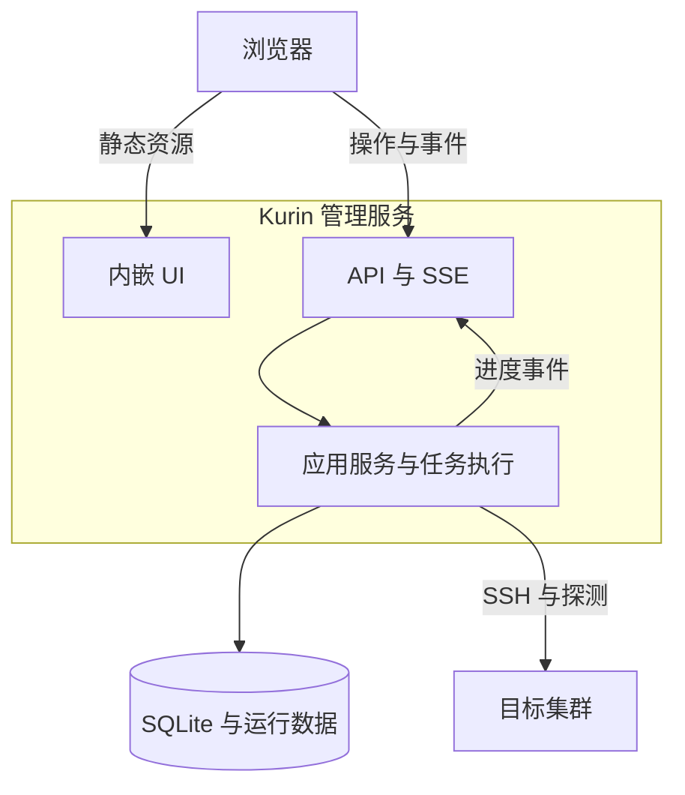
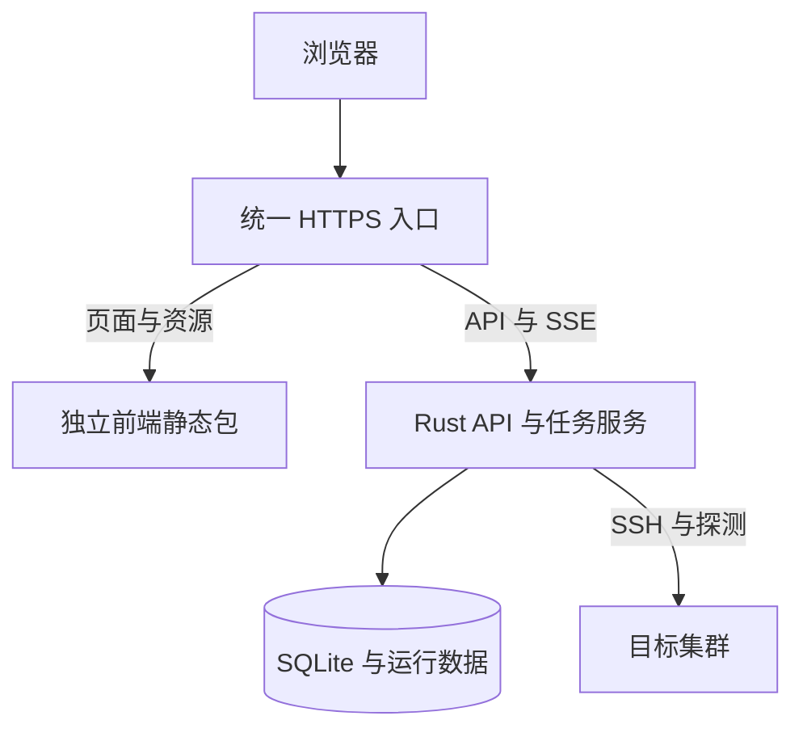
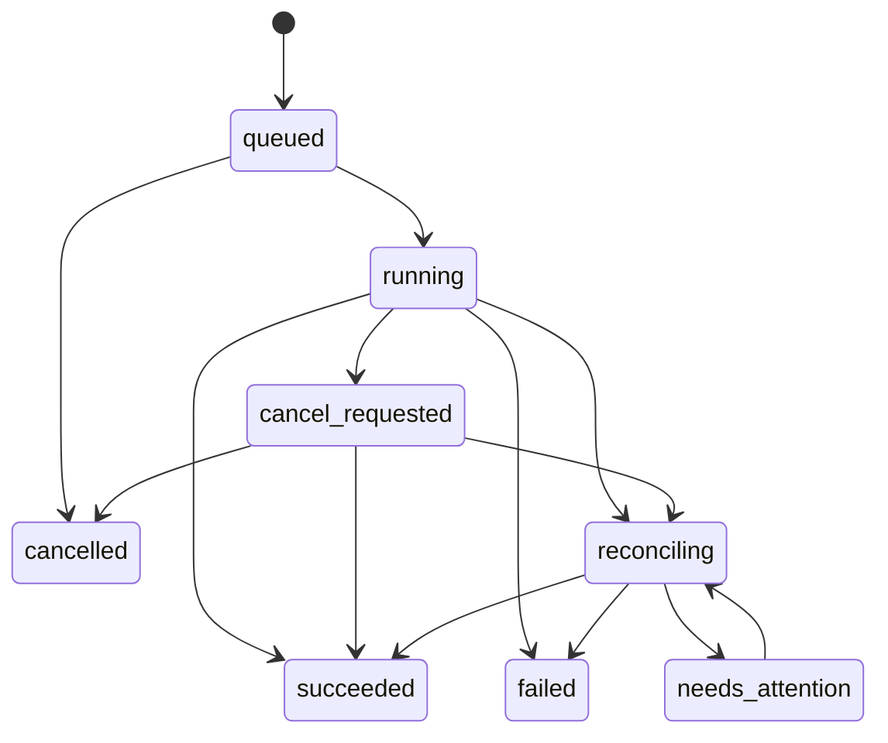

# Kurin Web UI 架构与实施方案

> **文档状态：设计草案 v1.0**  
> **整理日期：2026-10-27（Asia/Shanghai）**  
> **项目：[weironz/kurin](https://github.com/weironz/kurin)**  
> **代码基线：v0.4.0，提交 `cbee2f10eb708e46011a580586425378cb22c659`**
>
> 本文保留“前后端一体交付”和“前后端分离部署”两种方案，供开发评审和任务拆分使用。除明确标为“现有”的能力外，本文中的 Web 页面、HTTP API、`serve` 命令、Cargo feature、数据库结构和服务配置均为拟议设计。本次进行了代码与官方文档核对，没有实现这些功能，也没有对 Web 版本进行编译、容量或故障测试。

## 目录

1. [结论与关键决策](#1-结论与关键决策)
2. [目标、范围与首版交付标准](#2-目标范围与首版交付标准)
3. [现有项目基线](#3-现有项目基线)
4. [共同架构与技术栈](#4-共同架构与技术栈)
5. [方案 A：前后端一体交付](#5-方案-a前后端一体交付)
6. [方案 B：前后端分离部署](#6-方案-b前后端分离部署)
7. [两种方案对比与选择条件](#7-两种方案对比与选择条件)
8. [前端页面与交互设计](#8-前端页面与交互设计)
9. [TOML 配置与凭据管理](#9-toml-配置与凭据管理)
10. [后台任务与执行语义](#10-后台任务与执行语义)
11. [事件、日志与 SSE](#11-事件日志与-sse)
12. [多集群状态采集](#12-多集群状态采集)
13. [数据模型与持久化](#13-数据模型与持久化)
14. [API 契约草案](#14-api-契约草案)
15. [代码组织与构建发布](#15-代码组织与构建发布)
16. [二进制体积与资源控制](#16-二进制体积与资源控制)
17. [部署、升级与离线运行](#17-部署升级与离线运行)
18. [现有代码改造优先级](#18-现有代码改造优先级)
19. [实施阶段与验收](#19-实施阶段与验收)
20. [决策记录与后续演进](#20-决策记录与后续演进)
21. [参考资料](#21-参考资料)

## 1. 结论与关键决策

建议 Kurin 采用以下总体方案：

> **同一仓库维护独立的前端工程和 Rust 后端，通过稳定 API 连接；生产交付同时支持一体交付与分离部署，两种模式共享业务核心、任务模型和前端代码。**

一体交付作为默认安装方式，优先满足单管理节点、离线 IDC 和低维护成本需求。分离部署作为正式支持的选项，面向企业现有网关、独立前端发布和门户集成需求。

### 1.1 区分三个不同的问题

| 决策维度 | 本方案建议 | 含义 |
|---|---|---|
| 前端是否独立工程 | 是 | `web/` 有独立的依赖、构建、类型检查和页面代码 |
| 前端是否独立 Git 仓库 | 首版不拆 | 前后端在同一提交中更新，方便契约和版本联动 |
| 前端是否独立部署 | 同时支持 | 可以嵌入 Rust，也可以由静态服务器单独提供 |

“独立前端工程”不意味着必须增加生产 Node.js 服务；React/Vite 的浏览器应用可以构建为静态资源，由 Rust 或静态服务器托管。[Vite 生产构建说明][S01]

### 1.2 推荐技术栈

| 层次 | 推荐方案 |
|---|---|
| 前端 | React + TypeScript + Vite |
| UI 组件 | Ant Design |
| 服务端数据状态 | TanStack Query |
| 页面路由 | React Router |
| HTTP 服务 | Rust + Axum + Tokio |
| 持久化 | SQLite + SQLx，首版单 Server 实例 |
| 普通接口 | REST + JSON DTO |
| 任务进度 | SSE + 持久化事件 |
| API 契约 | utoipa/OpenAPI + openapi-typescript |
| 一体交付资源 | rust-embed；也支持随容器提供静态目录 |
| 分离交付资源 | 静态包 + Nginx 或现有企业网关 |
| 用户配置格式 | **TOML，保留已经选定的方向** |

以上为推荐选型。具体依赖版本在实施时结合 Rust 工具链、MSRV、musl 构建和现有锁文件验证并固定，不把文档中的“最新版本”作为长期依赖策略。

### 1.3 首版架构边界

首版实现一个可持久化、可审计的集群管理服务：

- 一个 Kurin Server 管理多个集群。
- CLI 与 Web 复用集群操作核心。
- Web 提交操作后由后台执行，不依赖页面保持打开。
- 持久化操作记录、步骤进度、配置修订与状态快照。
- 未能确认的远端执行结果进入核对流程。
- 同一集群的变更操作互斥，不同集群的操作有界并发。

首版不承诺多实例 Server 高可用、分布式执行器、任意步骤自动回滚，或对所有远端命令实现“恰好执行一次”。

## 2. 目标、范围与首版交付标准

### 2.1 产品目标

通过浏览器覆盖 CLI 的主要集群生命周期操作，包括：

1. 导入或填写 TOML 对应的集群配置。
2. 校验配置、预检主机和查看操作计划。
3. 创建集群、增加节点、移除节点和销毁集群。
4. 展示多个集群及节点的最近状态。
5. 查看操作进度、结果、错误和历史。
6. 分阶段补齐升级、证书和离线制品管理。

UI 应围绕操作意图组织，不必把每个 CLI flag 原样复制成一个输入框。

### 2.2 CLI 能力与 UI 覆盖矩阵

左列来自现有命令入口；右列为建议新增的 UI 能力。发行版、CNI、架构及离线组合仍以核心校验和项目支持矩阵为准，不能因为 UI 中有选项就视为已经支持。[现有命令][K02]、[支持矩阵][K03]

| 现有能力 | 建议 UI | 执行方式 | 交付阶段 |
|---|---|---|---|
| `create config` | 配置模板、创建向导、TOML 导入导出 | 普通配置 API | P1 |
| `precheck` | 按节点展示连通性、系统与部署条件检查 | 有记录的检查任务 | P1 |
| `create cluster` | 配置、计划、确认、安装进度与结果 | 后台 Operation | P2 |
| `add nodes` | 增加节点、配置差异和加入进度 | 后台 Operation | P2 |
| `delete node` | 节点移除计划、影响说明与结果 | 后台 Operation | P2 |
| `delete cluster` | 集群销毁计划、明确确认与逐节点结果 | 后台 Operation | P2 |
| `status` | 多集群总览、集群详情、节点状态 | 后台采集与快照 | P1 |
| `upgrade` | 当前/目标版本、支持路径、升级计划与结果 | 后台 Operation | P3 |
| `certs check` | 证书有效期与检查错误 | 定期采集或检查任务 | P1/P3 |
| `certs renew` | 续期计划、执行与验证结果 | 后台 Operation | P3 |
| `artifact` 及服务端制品登记 | 预置离线包的校验与引用；后续补完整准备与管理界面 | 基础登记 / 制品任务 | P1/P2 基础，P3 增强 |
| 服务端新增能力 | 停止请求、核对中断任务、操作历史 | Operation 管理 | P2 |

**满足本次需求的首个完整 UI 版本应包含 P1 + P2。只读仪表盘属于中间里程碑。**

### 2.3 明确区分三种产品动作

| 动作 | 影响 |
|---|---|
| 登记集群 | 在平台中保存配置、身份和访问方式，不隐含安装 |
| 移除平台记录 | 停止纳管或归档记录，不执行远端销毁 |
| 销毁集群 | 对目标节点执行明确的破坏性清理流程，保留操作审计 |

不要把后两项合并成含义不清的“删除集群”按钮。

### 2.4 首版范围之外

- 通用 Kubernetes 工作负载管理平台，例如完整的 Deployment、Service、Ingress 编辑器。
- Grafana/Prometheus 的替代品，或长周期指标分析系统。
- 浏览器交互式 SSH 终端。
- 任意脚本、通用 Playbook DSL 和插件市场。
- 自动接管所有来源、所有形态的 Kubernetes 集群。
- 多租户计费、跨区域分布式调度和多实例控制平面。

已有集群的纳管应先要求提供可校验的配置与访问凭据，确认其形态处于 Kurin 支持范围内。

## 3. 现有项目基线

以下结论基于文档首页列出的提交，属于源码与项目文档核对结果，不代表本次重新运行了项目的真机测试。

| 已有基础 | 对 UI 开发的意义 | 需要补充的部分 |
|---|---|---|
| `kurin` 与 `kurin-config` 两个 workspace 成员 | 已有核心与配置模块边界 | 增加应用服务、HTTP、持久化和前端工程 |
| `main.rs` 中已有创建、节点、升级、状态等命令 | 有明确的操作范围 | 将仍在 CLI 内的业务编排提取出来 |
| `engine.rs` 有 Task、Outcome、结构化 Event | 可复用检查、执行和事件基础 | Operation 层、事件封装与统一输出 |
| `executor.rs` 有计划执行与恢复相关选项 | 无需从零编写执行引擎 | 服务生命周期、取消、持久化任务与互斥 |
| `state.rs` 保存任务完成记录 | 已有本地恢复基础 | 不能直接充当多用户任务数据库和队列 |
| `status.rs` 已能采集节点、Pod、etcd、证书信息 | 可作为后台采集起点 | 采集时间、分项错误、未知与陈旧状态 |
| `ssh.rs` 返回命令结束后的 stdout/stderr | 可以提供步骤结果和命令完成输出 | 实时逐行远端日志需要单独扩展接口 |
| 内部 Cluster 模型包含原始配置与凭据相关字段 | 执行器可以取得完整上下文 | 必须新增对外 DTO，避免直接返回内部模型 |

依据：[工作区][K01]、[命令入口][K02]、[引擎][K04]、[执行器][K06]、[状态文件][K07]、[状态采集][K08]、[SSH][K09]、[内部模型][K12]。

### 3.1 当前真实 TOML 结构

当前配置示例使用：

- `version = "v1alpha1"`。
- `key-path`、`pod-cidr` 等 kebab-case 键。
- `[nodes.master01]` 这样的命名节点表。
- 单值 `role`。

UI 应映射这套已经落地的结构。不要把早期讨论中的 `schema_version`、`[[nodes]]` 或 `roles` 数组写成现有格式。若将来需要改 schema，应单独设计版本迁移。[现有 TOML 示例][K13]

### 3.2 现有能力限制需要在 UI 中表达

例如当前项目支持矩阵对 k3s 常规升级和部分 CNI 离线组合有明确限制。UI 应读取后端的能力描述，禁用不支持的组合并说明原因；最终执行仍由后端校验。[支持矩阵][K03]

## 4. 共同架构与技术栈

### 4.1 共同业务边界

两种部署模式使用相同的逻辑分层。

| 模块 | 主要职责 | 不承担的职责 |
|---|---|---|
| Web UI | 表单、计划展示、进度、历史、状态可视化 | SSH 执行、保存私钥、决定操作最终成功 |
| HTTP API | 身份、权限、输入 DTO、幂等提交、查询 | 将长任务绑定到请求生命周期 |
| 应用服务 | 统一操作入口、校验、计划、配置修订 | 解析 CLI 终端文本作为业务协议 |
| Operation 调度 | 任务持久化、互斥、并发、停止、恢复 | 假设网络断开等于远端失败 |
| Kurin 核心 | 配置规范化、Task、SSH、制品和集群操作 | 依赖浏览器连接或 Web 页面状态 |
| Store | 登记、任务、事件、快照和审计 | 保存不受保护的凭据明文 |
| Collector | 定期状态采集、缓存、错误分类 | 每打开一个页面就完整扫描所有集群 |

CLI 保留两种使用方式：

- **本地 CLI 模式**：直接调用共享应用服务与核心，用于独立运维。
- **托管模式**：CLI 向 Kurin Server 提交操作，与 Web 使用同一调度入口。

托管模式的 CLI API 客户端属于新增能力；在实现前，不能宣称现有 CLI 已经与 Web 共享全局锁。

### 4.2 前端选型理由

**React + TypeScript + Vite** 用于静态 SPA。该工具主要是交互式运维控制台，没有首版必须依赖 SSR 或 SEO 的需求，采用静态前端可减少生产运行组件。[S01]

**Ant Design** 作为首选组件库，主要用于表格、表单、步骤向导、抽屉、弹窗和反馈提示。若以后高度定制视觉设计，再评估替换局部组件；首版不同时引入多套完整 UI 体系。[Ant Design 组件][S02]

**TanStack Query** 管理服务端数据的读取、缓存、刷新与 mutation 状态；AntD Form 管理表单草稿。页面筛选、弹窗和选中项等本地状态先使用 React 自身能力，暂不引入 Redux。[TanStack Query][S03]

**React Router** 管理多集群列表、集群详情、操作详情等路由，使用适合 SPA 的模式即可。[React Router 模式][S04]

### 4.3 后端与契约选型理由

- **Axum + Tokio**：与现有 Rust 异步执行能力衔接，Axum 提供 SSE 响应支持。[S05]
- **SQLx + SQLite**：首版保持单进程本地持久化，降低部署门槛。SQLx 提供数据库连接池和迁移能力；仅启用实际需要的驱动与运行时特性。[S06]
- **utoipa + OpenAPI**：从明确的 API DTO 和接口描述生成契约。[S07]
- **openapi-typescript**：生成前端类型；类型生成不替代服务端输入校验，也不自动保证业务语义兼容。[S08]
- **REST + SSE**：REST 提交命令与查询，SSE 推送任务事件。交互式终端等双向流需求出现时，再评估 WebSocket。

### 4.4 不同入口必须调用同一应用服务

例如创建集群应最终进入统一的 `create_cluster` 应用服务：

1. 验证配置和能力。
2. 固定配置修订、目标节点、凭据引用和制品版本。
3. 生成可展示的计划。
4. 执行前重新检查关键前提。
5. 调用共享执行核心。
6. 产生统一的步骤事件和结构化结果。

Web API 不应直接执行 `kurin create cluster ...` 再解析终端输出作为长期实现。临时进程隔离可以作为独立技术选择，但仍应使用明确的结构化协议和状态归属。

## 5. 方案 A：前后端一体交付

### 5.1 定义与运行形态

前端仍是独立的 `web/` 工程。发布时构建静态资源，再由 Rust 服务同时提供页面、API 和 SSE。

可以提供两种包装形态：

1. **单二进制**：通过 rust-embed 将静态资源嵌入可执行文件。
2. **单容器**：同一镜像包含 Rust 服务与静态资源；资源可嵌入，也可存放在镜像中的固定目录。

这两种形态都属于一体交付，但只有第一种一定把 UI 字节放在可执行文件内部。运行数据库、操作日志、凭据和缓存仍需独立的数据目录或持久卷。[rust-embed][S09]

### 5.2 部署结构



管理服务部署在独立管理机或虚拟机上，具有到目标节点的网络访问能力。不要让待创建或待销毁的集群成为唯一管理服务的运行依赖。

### 5.3 拟议使用入口

以下命令尚未实现，仅用于说明目标使用体验：

```bash
kurin serve --config /etc/kurin/server.toml
```

内嵌模式在同一来源提供：

| 路径 | 内容 |
|---|---|
| `/` | UI 页面 |
| `/assets/*` | 构建后的静态资源 |
| `/api/v1/*` | API 与操作事件 |
| `/healthz` | 管理服务存活检查 |
| `/readyz` | 数据库与任务服务是否可用 |

未知 API 路径返回 API 错误，不能被 SPA fallback 转成 HTML。

### 5.4 优点

- 安装路径短，适合希望下载后直接启动的 CLI 用户。
- 离线交付容易形成完整、固定版本的制品。
- UI 与 API 随同一版本发布，减少错配。
- 页面、API 和 SSE 默认同源，认证与连接配置较直接。
- 无需额外维护静态服务器。
- 适合小团队、单管理节点和早期快速迭代。

### 5.5 缺点与代价

- 内嵌 UI 会增加二进制体积。
- 发布构建需要先构建前端。
- 只改页面通常也需要重新发布整个应用包。
- 若替换运行中的服务，必须考虑正在执行的长任务。
- 前后端升级节奏被绑定，独立回退某一部分不方便。
- 一个进程内的程序故障可能影响多个集群操作；需要持久化与恢复机制控制影响。

### 5.6 适用条件

优先适用于：

- 单实例管理服务。
- 私有化与离线 IDC 部署。
- 运维人员同时使用 CLI 与浏览器。
- 希望减少服务数量和部署参数。
- 前后端由同一团队维护、发布节奏基本一致。

**建议将本方案作为 Kurin 的默认下载与安装体验。**

## 6. 方案 B：前后端分离部署

### 6.1 定义与运行形态

前端构建为独立静态包，由 Nginx、现有企业网关配套的静态服务或其他静态托管设施提供。Rust 后端只提供 API、任务服务、状态采集与持久化。

前后端仍可以位于同一仓库。分离部署也不要求立即引入多个 Rust Server 实例。

### 6.2 优先采用部署分离、浏览器同域

建议通过一个公共入口分流：

| 浏览器访问地址 | 实际目标 |
|---|---|
| `https://kurin.example.com/` | 前端静态服务 |
| `https://kurin.example.com/assets/*` | 前端静态资源 |
| `https://kurin.example.com/api/v1/*` | Rust API 与 SSE |



这样可以独立发布 UI，同时让浏览器继续使用相对 `/api/v1` 路径。前端和后端所在机器、容器或发布流水线可以不同。

### 6.3 反向代理要求

反向代理需要处理：

- API 路径保持正确，不误删 `/api/v1` 前缀。
- SSE 响应及时转发，并设置适当的空闲超时。
- API 响应不被静态缓存。
- SPA 页面 fallback 与 API、静态资源 404 分开。
- 入口 HTML 不长期缓存；内容哈希资源可以长期缓存。
- 只信任来自已配置代理的转发头。

以下是拟议 Nginx 路由片段，放入已经配置 HTTPS 的 `server` 块中。它说明路由关系，不包含证书、认证和主机环境的完整部署配置。

```nginx
root /srv/kurin/web;
index index.html;

location /api/ {
    proxy_pass http://127.0.0.1:8080;
    proxy_http_version 1.1;
    proxy_set_header Host $host;
    proxy_set_header X-Forwarded-Proto $scheme;
    proxy_buffering off;
    proxy_cache off;
    proxy_read_timeout 90s;
}

location /assets/ {
    try_files $uri =404;
    add_header Cache-Control "public, max-age=31536000, immutable";
}

location = /index.html {
    add_header Cache-Control "no-cache";
}

location / {
    try_files $uri $uri/ /index.html;
    add_header Cache-Control "no-cache";
}
```

这里的 90 秒为起步配置示例，应与 SSE 心跳及网关超时配合。Nginx 的 `proxy_buffering` 会影响上游数据是否立即传给客户端。[Nginx 代理文档][S10]

在容器分离部署中，`proxy_pass` 应改为实际后端服务地址；一个容器中的 `127.0.0.1` 不代表另一个容器。

静态包采用原子发布，避免用户读到半套新资源。保留兼容窗口内旧版本的哈希资源，支持已打开页面后续加载旧分块。可以采用共享的版本化资源存储，或让带版本前缀的资源 URL 持续可访问；仅保留磁盘上的旧目录、却切断其公开路由，并不能解决旧分块 404。无法继续兼容时，页面提示刷新，保存当前 operation ID 并在刷新后重新连接任务。入口 HTML 与公开运行配置不采用长期不可变缓存。[Vite 更新与分块说明][S01]

### 6.4 跨域部署作为备选

只有确实需要独立域名时，再采用：

- `console.example.com`：前端。
- `api.example.com`：后端。

此时必须明确允许的来源、凭据方式、预检处理和事件流认证。携带凭据的跨域请求不能简单使用通配来源代替配置；CORS 也不是后端权限校验。[Fetch/CORS 标准][S11]

建议支持部署时的公开运行配置，例如 API base URL，而不是为每个机房重新构建前端。运行配置不得包含密码、私钥、访问令牌或数据库连接密码。

浏览器原生 EventSource 的构造参数不提供任意请求头设置。若 API 采用 Bearer header 认证，需要选择支持流式 Fetch 的客户端，或采用与同源会话适配的 SSE 认证方式；不要把长期令牌塞进 URL。[EventSource 标准][S12]

### 6.5 优点

- UI 更新可以独立于后端，不必仅因页面修改就重启任务服务。
- 容易接入企业已有网关、认证入口与静态托管设施。
- 前端资源可以独立缓存、发布和回退。
- 方便未来企业门户或其他客户端复用同一 API。
- 后端二进制不必包含 UI 资源。
- 前后端开发与发布职责更容易独立。

### 6.6 缺点与代价

- 需要维护更多制品和部署配置。
- 前后端必须有明确的版本兼容规则。
- SSE、认证、缓存和代理配置增加联调内容。
- 故障定位要区分静态服务、网关和 API。
- 离线交付需要同时准备前端包、后端包及必要的代理制品。
- 二进制变小不代表整体交付资源消失；静态包仍需要分发和保存。

### 6.7 适用条件

优先适用于：

- 已有统一企业网关与静态托管设施。
- UI 迭代频繁，希望与长任务执行服务独立升级。
- 希望嵌入已有企业门户。
- 有多个客户端调用同一 API。
- 前后端由不同团队维护，确有独立发布需求。

## 7. 两种方案对比与选择条件

| 维度 | 方案 A：一体交付 | 方案 B：分离部署 |
|---|---|---|
| 前端开发方式 | 独立工程 | 独立工程 |
| 是否必须分仓库 | 否 | 否 |
| 生产 Node.js 服务 | 静态 SPA 不需要 | 静态 SPA 不需要 |
| 主要制品 | 应用二进制或单镜像 | 后端包、前端静态包、代理配置 |
| 初次安装 | 较简单 | 配置项更多 |
| 离线交付 | 易于整体封装 | 需要完整的多制品清单 |
| API/UI 版本匹配 | 同版本发布较自然 | 必须管理兼容范围 |
| UI 单独更新 | 通常重发整体包 | 可以独立更新 |
| 后端二进制大小 | 包含嵌入的 UI 时更大 | 不包含 UI 资源 |
| 总交付内容 | 核心、后端、前端资源 | 同样需要核心、后端、前端资源 |
| 运行数据 | 外部数据目录或持久卷 | 后端数据目录或持久卷 |
| CORS | 默认同源 | 同域反代时同样可避免跨域配置 |
| 执行可靠性 | 取决于共同任务设计 | 取决于共同任务设计 |
| 企业设施集成 | 可以集成 | 更适合独立前端发布 |
| 多实例后端 | 首版不支持 | 分离部署也不自动支持 |

### 7.1 当前建议

默认提供方案 A，同时保证方案 B 不需要更改业务代码：

- 同一个 `web/` 构建产物可以被嵌入，也可以单独发布。
- 同一套 Rust API 支持两种入口。
- 静态资源托管方式由构建能力和启动配置决定。
- 第一版前后端仍从同一个 Git tag 发布。
- 建立 API 契约测试后，再逐步扩大独立升级范围。

### 7.2 从 A 切换到 B 的条件

以下任一需求稳定出现时，可以选择 B：

- UI 更新频率显著高于后端，整体发布已影响维护效率。
- 管理服务频繁执行长任务，页面更新不应触发服务替换。
- 企业已经有统一网关、静态站点与认证体系。
- 需要多个不同前端调用 Kurin API。
- 已有独立前后端发布与兼容性管理能力。

仅因为前端工程目录变大，或希望可执行文件看起来更小，不足以证明必须拆部署。

## 8. 前端页面与交互设计

### 8.1 建议的信息架构

| 页面 | 主要内容 |
|---|---|
| 集群总览 | 集群名称、站点、分布、版本、节点数、健康、可达性、最后检查、当前操作 |
| 集群详情 | 节点、配置修订、状态分项、证书、最近操作 |
| 新建配置 | 模板、基本信息、网络、节点、凭据绑定、校验 |
| 操作计划 | 配置差异、目标节点、步骤、风险影响、支持限制 |
| 操作详情 | 生命周期、阶段、节点结果、事件、输出、错误和后续建议 |
| 操作历史 | 按集群、类型、操作者、状态和时间筛选 |
| 凭据管理 | 服务端凭据登记、绑定、轮换、权限；不回显秘密 |
| 制品管理 | 可用离线包、版本、架构、完整性和准备任务 |
| 服务设置 | 采集周期、并发限制、用户与权限、保留策略 |

首版先完成集群总览、详情、配置、计划、操作详情和基础凭据管理。更丰富的趋势图与自定义仪表盘后置。

### 8.2 创建集群流程

1. 创建草稿，选择受支持的集群形态。
2. 填写或导入 TOML 对应的配置。
3. 绑定服务端可访问的凭据；离线创建时选择已登记、已校验的制品包。
4. 后端进行 schema 与业务约束校验。
5. 执行预检，逐节点展示结果。
6. 生成计划并展示目标、配置修订和预期步骤。
7. 用户确认后提交 Operation。
8. 跳转操作详情；刷新和关闭浏览器不影响后台执行。
9. 操作结束后刷新状态快照，展示执行结果与观测结果。

预检通过只说明当时检查通过，不保证执行时环境没有变化。

### 8.3 销毁与移除流程

销毁前展示：

- 稳定的集群身份与显示名称。
- 将操作的节点、地址及管理范围。
- 将清理的服务和数据类别。
- 当前运行中的操作及阻塞原因。
- 计划对应的配置修订。

提交时要求确认明确对象，后端仍需检查权限、计划一致性和操作互斥。普通节点移除与强制清理使用不同的明确策略，不能把强制驱逐选项隐藏在默认行为中。

集群部分节点不可达时，应展示逐节点结果；不能仅以一个绿色“完成”掩盖未清理节点。

### 8.4 页面状态必须表达不确定性

操作进度至少能表现：

- 等待执行。
- 正在执行。
- 停止请求已提交。
- 正在核对远端状态。
- 已成功、已失败、已取消。
- 需要人工处理。

集群状态至少能表现：

- 当前观测健康。
- 已观测到异常。
- 无法确认。
- 连接不可达。
- 数据已过期。

“操作成功”和“最近健康检查通过”是两个不同字段。

## 9. TOML 配置与凭据管理

### 9.1 TOML 与 JSON 的边界

| 数据 | 建议形式 |
|---|---|
| 用户编写、导入、导出的部署配置 | TOML |
| 浏览器与 API 的请求、响应 | JSON DTO |
| 平台登记、标签、凭据绑定、采集策略 | 数据库中的管理元数据 |
| 执行前的有效配置 | Rust 规范化模型 |
| 操作的固定输入 | 配置修订、目标集合、制品清单与受控凭据引用 |

API 使用 JSON 不改变用户配置选择 TOML 的决定。也无需把下游 kubeadm、Helm 或 Kubernetes 原生文件全部改成 TOML。

### 9.2 复用后端校验

表单校验用于即时提示，后端校验作为最终依据：

1. 解析输入。
2. 校验配置版本和未知字段。
3. 补充约定的默认值。
4. 对非秘密配置进行跨字段与支持组合检查，形成托管草稿。
5. 检查执行就绪条件时，解析凭据绑定和制品引用，在内存中构造完整执行输入。
6. 对组合后的输入进行完整业务、认证和资源校验。
7. 以非秘密配置与绑定信息保存修订，并生成可展示计划。

采用“草稿结构校验”和“完整执行校验”两个阶段。服务层新增托管草稿模型，抽取并复用核心校验；现有 CLI 完整配置的校验行为保持明确。缺少认证信息的草稿可以保存为未就绪状态，但不能提交执行，不能用伪造密码占位符绕过校验。

凭据只在受控内存中合入临时执行模型，不把补齐秘密后的 TOML 或整个内部 Cluster 写入配置修订。导入含秘密的原始 TOML 时，先将认证材料交给凭据管理，再保存非秘密修订；原始输入、诊断和临时执行输入都不进入普通日志与 API。验收须覆盖：无凭据草稿可保存、缺绑定拒绝执行、绑定后可验证、数据库和错误输出不包含临时注入的秘密。

不要在 TypeScript 中再实现一套与 Rust 不同步的集群支持矩阵。

### 9.3 配置修订和并发编辑

每次保存产生不可变 revision，当前集群记录只指向最新 revision：

- 表单与高级 TOML 编辑器关联同一个 revision。
- 提交保存时携带上一 revision 或 ETag，防止无提示覆盖其他人的修改。
- Operation 固定提交时的配置修订。
- 用户后续修改草稿，不改变已提交任务。
- 计划需要绑定 revision 和指纹；执行前验证其仍适用于关键远端条件。

若需要保留用户注释与布局，使用能保留 TOML 编辑信息的机制单独实现；不要承诺普通反序列化再序列化就能原样保留文件。

### 9.4 对外 DTO 不直接使用内部 Cluster

当前内部模型包含完整原始配置文本及凭据相关字段。[内部模型][K12]

建议分别定义：

- `ClusterSummaryDto`：列表数据。
- `ClusterDetailDto`：详情数据。
- `ClusterConfigDto`：可编辑的非秘密配置。
- `CredentialRefDto`：凭据标识、类型及可用状态。
- `OperationDto`：任务生命周期与结果。
- `PlanDto`：可展示、可持久化的计划摘要。

配置解析错误、任务日志和诊断上下文也必须经过秘密字段处理，避免原始 TOML 被附带返回。

### 9.5 凭据与路径规则

Web 模式下，SSH 连接由管理服务发起：

- 浏览器电脑上的 `C:\Users\...\id_ed25519` 不等于服务器上的文件。
- 浏览器输入的离线包目录不意味着后端可以访问它。
- 通过服务端已登记的 credential ID、artifact bundle ID 绑定资源。
- 文件上传是需要单独实现的能力，不能依赖文本框中的本地路径。
- 为私钥文件引用建立受控目录和权限，不开放任意服务端文件读取接口。
- 密码、私钥内容、口令、join token 不写入普通 DTO、事件、审计详情或浏览器持久存储。
- 如保存密码或私钥口令，使用经过审查的加密封装，主密钥与数据库备份分离管理。
- 密钥轮换应保留必要的版本信息，正在执行的操作使用已选定的凭据版本或明确的轮换策略。

凭据绑定属于服务端管理元数据。不要直接往现有严格 TOML schema 中增加 `credential-id` 等未定义字段；如果未来允许配置直接引用凭据，需要单独发布 schema 变更。

默认配置导出不携带秘密。导出内容如果需要在另一环境运行，必须说明需重新绑定凭据，不能把脱敏占位符伪装成可以立即执行的有效认证配置。

离线安装的最低限度制品登记放在 P1/P2：管理员预置 bundle，通过受控的服务端配置或管理入口完成清单、版本、架构与完整性校验，再提供 bundle ID 给创建流程选择。P3 再补在线准备、上传下载和完整管理页面。浏览器不通过输入任意服务端目录来绕过登记。

## 10. 后台任务与执行语义

### 10.1 核心原则

创建、增加节点、移除、销毁、升级和续期都作为后台 Operation 执行：

1. API 校验权限和请求。
2. 在数据库事务中写入操作、固定输入和幂等信息。
3. 提交成功后返回 `202 Accepted` 与 operation ID。
4. 调度器读取持久化任务并获取操作所有权。
5. 执行期间持续保存事件与步骤结果。
6. 页面查询快照或订阅 SSE。

HTTP 202 表示请求已接受处理，不代表集群操作已经完成。[HTTP 语义][S13]

不要把唯一的任务队列放在内存 channel 中，也不要仅在请求处理器里 `spawn` 一个没有持久化归属的 future。

### 10.2 Operation 生命周期与步骤结果分开

建议 Operation 使用：

| 状态 | 含义 |
|---|---|
| `queued` | 已持久化，尚未开始 |
| `running` | 当前执行器正在执行 |
| `cancel_requested` | 已请求停止，等待合适边界或远端结果 |
| `reconciling` | 正在核对中断或未知结果 |
| `succeeded` | 约定的后置验证通过 |
| `failed` | 已明确确认失败 |
| `cancelled` | 后续执行已停止，已知影响已记录；不代表回滚 |
| `needs_attention` | 无法自动确认或继续，需要人工处理 |

步骤级结果另行保存 `pending`、`running`、`verified`、`skipped`、`failed`、`unknown`。

`interrupted` 可以作为中断原因记录，例如服务重启、进程崩溃或超时；它不等同于远端失败。现有 `Outcome::Unknown` 可以保留并在 Operation 层承接。[引擎源码][K04]



该图展示主要路径。实现时还需覆盖停止请求后的明确失败、核对后确认已停止等分支，并通过状态转换约束避免随意覆盖终态。

### 10.3 每次操作的不可变输入

至少固定：

- `operation_id`、`cluster_id`、操作类型。
- 配置 revision 与规范化后输入摘要。
- 目标节点的稳定 ID、地址与必要身份核对信息。
- 计划指纹和步骤描述。
- Kurin 版本、构建标识。
- 制品版本、架构、清单 digest 与来源策略。
- 凭据引用与必要版本标识。
- 操作者、创建时间和确认记录。
- `retry_of` 等历史关联。

当前计划包含运行时 Task 对象，不能假设把现有 Plan 直接序列化即可恢复。需要持久化 Plan DTO，或保存足够数据以在兼容版本下重新构建步骤。[引擎中的计划对象][K04]

### 10.4 每次操作使用独立 ExecutionContext

执行上下文至少包含：

| 内容 | 原因 |
|---|---|
| 配置快照与稳定身份 | 避免编辑配置影响运行中的操作 |
| zone、制品 manifest、版本与架构 | 避免多个集群互相污染 |
| 凭据解析器和 SSH pool | 控制执行范围与秘密生命周期 |
| 工作目录、join material 和日志位置 | 隔离运行产物 |
| EventSink | 统一 CLI 与 Web 的进度出口 |
| 停止请求状态和执行期限 | 实现可说明的停止语义 |

现有进程级 `OnceLock` 不能用于保存每个集群不同的 zone 或 manifest。它在常驻服务中会保留首次设置的值，串行执行多个集群也可能受到影响。[artifact.rs][K05]

### 10.5 并发与互斥

首版推荐：

- 单 Server 实例。
- 同一集群最多一个未解决的变更操作进入执行。
- 不同集群设置全局并发上限。
- 节点级并发服从现有阶段与角色约束。
- 读操作独立限流，不与写操作共享无限并发。
- 对同一管理范围内重复登记的主机进行检查，避免同一主机同时属于两个受管集群。

互斥必须通过数据库事务和明确的操作所有权实现；进程内 Mutex 只能作为补充。

**CLI 与 Web 的协调约束：**

- 托管集群的写操作统一提交给 Server。
- 尚未实现远程 CLI 时，明确不支持本地 CLI 与 Server 同时修改同一组目标。
- 同机文件锁或数据库锁不能自动解决不同管理机之间的竞争。
- 前端禁用按钮不是互斥机制。
- 锁或租约过期不能证明远端进程已经停止；有未知结果的集群保持变更阻塞，直到核对完成。

### 10.6 幂等提交与远端幂等分开

API 提交支持幂等键，并绑定请求摘要：

- 相同键、相同请求：返回同一 operation。
- 相同键、不同请求：返回冲突。
- 网络重试不应产生重复的创建或销毁任务。

这只解决重复提交。远端变更仍需检查、执行、验证和未知结果核对，不能声称 HTTP 幂等键保证远端“恰好执行一次”。

### 10.7 停止、重启与恢复

**停止：**

- 排队任务可以直接取消，确保没有开始执行。
- 执行中的任务接受停止请求，在允许停止的步骤边界停止后续调度。
- 正在执行的远端命令需要等待结果或核对。
- 丢弃 future、关闭 SSH 或断开 SSE，不代表远端命令已经停止。
- 已执行的变更不会因为任务被取消而自动回滚。

**重启：**

1. 加载未完成操作。
2. 将上次仍在运行的操作标记为需核对。
3. 保留其配置、目标、步骤和错误记录。
4. 探测远端真实状态。
5. 能明确判断的结果落到相应状态；其余进入 `needs_attention`。

首版优先实现可见的中断记录、重新检查与受控重试。自动续跑只对已明确验证安全的步骤逐步开放。重试创建新 operation 并关联原操作，保留历史。

### 10.8 核对完成、解除阻塞与重试

`needs_attention` 不能成为永久无法退出的状态，也不能通过普通重试按钮隐式解锁。需要一个受控的解决流程：

1. 核对远端动作已结束，或现场处置已经使目标进入可确认的稳定状态。
2. 保存影响范围、检查证据、处理说明与操作者。
3. 将旧操作转入有依据的终态：目标验证通过则成功；明确未完成目标则失败；按停止语义完成则取消。
4. 在同一事务中记录解决事件并解除该集群的变更阻塞。
5. 后续重试重新生成计划，创建关联 `retry_of` 的新 operation。

无法确认远端状态时继续阻塞。人工解决入口需要独立权限与审计，不提供无条件“释放锁”按钮。验收既要证明未知结果不会放行并发变更，也要证明现场处置完成后存在可审计的恢复入口。

## 11. 事件、日志与 SSE

### 11.1 统一事件出口

现有任务事件适合用作基础，但需要为升级、销毁、证书等操作补齐一致的 EventSink。终端渲染、数据库存储和 SSE 分发分别作为消费者。[现有 Event][K04]

建议采用外层事件信封，保留内部事件兼容空间：

```json
{
  "schema_version": 1,
  "operation_id": "op_example",
  "sequence": 42,
  "timestamp": "2026-10-27T04:00:00Z",
  "payload": {
    "type": "task-start",
    "id": "prepare-container-runtime",
    "node": "worker01",
    "stage": "prepare"
  }
}
```

以上为接口示例，不代表当前 CLI 已输出该信封。

### 11.2 持久化与重放

- 每个 operation 的 sequence 单调递增。
- 事件保存成功后再通知订阅者。
- 关键步骤结果、operation 状态转换及对应事件在同一数据库事务中提交。
- 用数据库唯一约束防止重复 sequence。
- SSE 的 `id` 对应该序号。
- 断线后使用 `Last-Event-ID` 或显式 cursor 补读。
- 避免历史补读与实时订阅之间出现漏事件窗口。
- 客户端按 operation ID 与 sequence 去重。
- 历史已清理时返回明确的重新同步要求，再读取当前操作快照。
- SSE 连接结束不改变任务执行状态。

EventSource 提供重连和 Last-Event-ID 机制，但历史保存、补读、去重与保留策略都需要应用自己实现。[S12]

EventSink 必须具有持久化失败的返回或确认通道。当前执行器的事件回调接口不能直接承担这个保证，需要适配。[executor.rs][K06] 每个远端变更步骤开始前先保存必要的执行意图与检查点；关键检查点无法保存时，不启动新的变更步骤，也不报告成功。远端动作已经发生但本地提交失败时，以最近的持久化记录为恢复起点，后续核对真实状态。本地数据库事务不能与远端 SSH 副作用构成原子事务。

浏览器分发失败与关键状态保存失败分开处理：前者不影响后台执行；后者阻止继续调度变更，并在存储恢复后保存需要核对的信息。逐行普通日志可以批量或文件化保存，不要求每条文本都更新 operation 主表。

### 11.3 慢客户端与内存边界

- 任务执行不等待浏览器消费事件。
- 事件订阅使用有界缓冲。
- 消费落后时允许断开订阅，由客户端从持久化 cursor 重连。
- 高频日志分批写入、限制单条长度，设置操作级保留策略。
- 日志存储满时必须产生明确状态与告警，不能悄悄丢失关键结果。
- 对 SSE 设置心跳，并与反向代理超时匹配。

### 11.4 实时步骤与逐行输出分阶段实现

当前 SSH 接口在命令结束后返回完整 stdout/stderr；已有步骤事件不等同于逐行日志流。[ssh.rs][K09]

建议：

- P2：实时步骤进度、操作级事件、命令完成后的输出与错误摘要。
- 后续增强：扩展 SSH/Session 流式接口，提供逐行 stdout/stderr。
- 所有输出在保存和发送前进行秘密处理。
- 大日志视图使用分页或虚拟列表，避免把完整历史一次性放进浏览器。
- 不为展示部署日志而提前加入完整交互终端。

## 12. 多集群状态采集

### 12.1 后台采集，页面读取快照

集群总览 API 直接读取最近快照。后台 Collector 按计划刷新，手动刷新请求进入同一去重、限流路径。

不能让多个浏览器同时打开页面就触发多倍 SSH 扫描。

### 12.2 快照字段

建议每个集群及分项检查记录：

| 字段 | 含义 |
|---|---|
| `observed_at` | 当前展示数据的观测时间 |
| `last_attempt_at` | 最近一次采集尝试时间 |
| `last_success_at` | 最近一次满足成功条件的采集时间 |
| `reachable` | 本次探测通路是否可达；可表达未知 |
| `health` | `healthy / degraded / unknown` |
| `stale` | 是否超过该检查的有效期 |
| `checks` | 各检查项的结果、错误和观测时间 |
| `active_operation` | 当前正在影响集群的操作 |

失败采集不应把节点数量写成零，也不应让过期快照继续显示为当前健康。保留上次有效数据，同时明确标记其时间和当前不确定性。

### 12.3 分层采集

以下数值是起步配置建议，不是性能测试结论：

| 检查 | 初始策略示例 |
|---|---|
| 节点/API 基础状态 | 每 60 秒 |
| 基础快照陈旧阈值 | 180 秒，可配置 |
| 证书检查 | 每 6 小时或按需 |
| 大范围预检 | 用户触发或执行前触发 |
| 全局同时采集的集群数 | 初始 4，按管理机与网络调整 |
| 全局同时执行的集群变更数 | 初始 2，按操作类型调整 |

添加超时、抖动、退避和单集群失败隔离。重型证书检查不应与每次基础状态请求绑定。

### 12.4 现有采集逻辑的边界

当前采集以首个控制平面 SSH 为入口，部分检查失败会使整次调用失败；现有汇总布尔值也不足以表达分项未知。[status.rs][K08]

因此：

- 首个控制平面不可达，不直接等价为整个集群故障。
- 先展示探测通路失败。
- 后续增加其他控制平面或 API 入口回退。
- 当前 etcd 检查属于已有探测范围，不能在 UI 上包装为完整的 etcd 性能或一致性诊断。
- 将“配置期望节点”和“实际观测节点”分别保存与展示。

## 13. 数据模型与持久化

### 13.1 首版 SQLite 的边界

首版采用本机 SQLite，保持单 Server 实例。多集群本身不构成必须使用 PostgreSQL 的理由。

SQLite 同一数据库同时只允许一个写者，因此任务事件和日志需要短事务、适当批处理及写入量控制。真正需要多个后端实例、数据库独立部署或已测得持续写入瓶颈时，再评估 PostgreSQL。[SQLite 适用场景][S14]

切换数据库并不自动获得分布式调度能力；届时仍需设计执行所有权、租约、恢复和防止旧执行器继续写入的机制。

### 13.2 建议的数据实体

| 实体 | 核心内容 |
|---|---|
| `clusters` | 稳定 ID、显示名称、站点、标签、当前配置 revision、管理状态 |
| `nodes` | 稳定节点 ID、归属、地址、名称、身份核对信息 |
| `config_revisions` | 不可变配置、摘要、创建人、创建时间；秘密外置 |
| `credentials` | 类型、受控引用或加密材料、版本、权限元数据 |
| `cluster_credential_bindings` | 集群/节点与凭据的绑定 |
| `artifact_bundles` | 制品版本、架构、清单 digest、路径与校验状态 |
| `operations` | 类型、状态、固定输入、计划、操作者、时间和结果 |
| `operation_steps` | 步骤顺序、节点、尝试、结果、错误与验证信息 |
| `operation_events` | operation ID、sequence、时间、类型和脱敏 payload |
| `cluster_snapshots` | 最新与必要历史观测 |
| `cluster_locks` | 当前变更所有权与核对阻塞状态 |
| `audit_events` | 谁在何时对什么对象发起何种操作 |

大段原始日志可以放在按 operation 分段的日志文件中，数据库保存索引与摘要，避免逐字节写入主表。

### 13.3 身份与目录隔离

- Cluster ID 与可编辑的显示名称分开。
- Node ID、节点名称、IP、SSH host key 和 Kubernetes Node UID 分开保存。
- 不假设 Kubernetes 提供可直接使用的统一 Cluster UID 字段。
- 若使用 CA 指纹或特定命名空间 UID 核对远端身份，需要明确其语义和重装后的变更处理。
- 状态目录、join material 与日志按稳定 ID 或 operation ID 隔离。
- 制品缓存按版本、架构和 digest 标识，使用临时文件与原子发布控制并发。
- 重命名集群不改变其操作历史。
- IP 指向新机器或 SSH 身份改变时，先核对，不能沿用旧身份直接销毁。

### 13.4 保留、备份与恢复

- 为事件、日志和历史快照分别设置保留策略。
- 不清理仍在运行或尚未核对操作所需的证据。
- 集群记录移除采用归档或保留审计的策略。
- 使用数据库支持的备份机制或受控停机备份，避免随意复制正在写入的数据库文件。
- 备份覆盖数据库、必要运行材料及凭据恢复所需的信息；主密钥另行保护。
- 恢复后先核对远端状态，不能把备份中的 running 状态直接当作仍在执行。

### 13.5 纳管移除与任务协调

存在 queued、running、cancel_requested、reconciling 或未解决 needs_attention 变更操作时，拒绝移除纳管并返回 409。先取消未开始任务，或完成正在执行与中断任务的处置。

纳管移除采用软归档，停止后续采集，处理已有采集请求，并保留稳定 ID、历史与身份冲突检查记录。不能通过重新登记同一目标绕过旧操作的阻塞。销毁成功默认更新集群生命周期状态，不自动删除集群记录、逐节点结果、审计或共享凭据。

## 14. API 契约草案

### 14.1 接口原则

- 统一前缀 `/api/v1`。
- 请求和响应使用专门 DTO。
- API JSON 字段可采用 snake_case；不要求与 TOML 的 kebab-case 完全一致。
- 长任务创建返回 operation ID。
- 修改配置使用 revision 或 ETag 控制并发。
- 变更提交支持幂等键。
- 所有权限检查在后端完成。
- 版本与 capability 信息来自服务端。
- API 标为 v1 不代表可以随意修改字段或行为。

### 14.2 建议端点

以下路径均为设计草案。

| 方法与路径 | 用途 | 语义 |
|---|---|---|
| `GET /api/v1/meta` | 服务版本、API 版本、能力集 | 普通查询 |
| `GET /api/v1/clusters` | 多集群列表与最近状态摘要 | 读取快照 |
| `POST /api/v1/clusters` | 登记配置与集群 | 不隐含安装 |
| `POST /api/v1/clusters/import` | 导入 TOML | 解析并登记草稿 |
| `GET /api/v1/clusters/{id}` | 集群详情 | 普通查询 |
| `PUT /api/v1/clusters/{id}/config` | 保存新配置修订 | 并发控制 |
| `GET /api/v1/clusters/{id}/config/export` | 导出非秘密配置 | 明确凭据重绑定要求 |
| `POST /api/v1/configs/validate` | 语法与业务校验 | 不执行集群变更 |
| `POST /api/v1/clusters/{id}/plans` | 生成操作计划 | 固定 revision 和目标 |
| `POST /api/v1/clusters/{id}/operations` | 预检或提交集群操作 | 202 + operation ID |
| `GET /api/v1/clusters/{id}/status` | 最近状态与观测时间 | 读取快照 |
| `POST /api/v1/clusters/{id}/status/refresh` | 请求刷新 | 去重、限流后排队 |
| `GET /api/v1/operations` | 操作列表 | 过滤与分页 |
| `GET /api/v1/operations/{id}` | 操作快照与结果 | 普通查询 |
| `GET /api/v1/operations/{id}/events` | 事件流 | SSE 与 cursor 重放 |
| `POST /api/v1/operations/{id}/cancellation` | 请求停止 | 不承诺立即终止远端命令 |
| `POST /api/v1/operations/{id}/reconcile` | 请求核对中断结果 | 有记录的核对流程 |
| `POST /api/v1/operations/{id}/resolution` | 登记并验证人工处置后的解决结果 | 独立权限、证据与审计，不是无条件解锁 |
| `DELETE /api/v1/clusters/{id}` | 软归档纳管记录 | 不执行远端销毁；存在未解决变更时返回 409 |

制品、凭据、用户和审计接口按实体补充。制品准备可使用不绑定集群的后台任务，不能为了复用路由而伪造集群归属。

计划生成如果只做本地计算，可以同步返回；如果需要长时间远端探测，应拆成检查任务，避免同步 API 长时间占用连接。

### 14.3 变更提交示例

```http
POST /api/v1/clusters/clu_example/operations
Content-Type: application/json
Idempotency-Key: create-prod-example-001
```

```json
{
  "kind": "create_cluster",
  "config_revision": 7,
  "plan_id": "plan_example",
  "confirmation": {
    "cluster_name": "prod"
  }
}
```

新操作响应：

```http
HTTP/1.1 202 Accepted
Location: /api/v1/operations/op_example
Content-Type: application/json
```

```json
{
  "operation_id": "op_example",
  "cluster_id": "clu_example",
  "state": "queued",
  "status_url": "/api/v1/operations/op_example",
  "events_url": "/api/v1/operations/op_example/events"
}
```

operation 的目标、配置和凭据绑定由服务端根据已经保存的计划解析。请求不能通过随意传入路径或 shell 字符串绕过计划与校验。

相同幂等请求再次到达时可以返回已有操作的当前结果；相同键对应不同内容则返回 409。记录保留期限应覆盖操作生命周期及明确的重试窗口。

### 14.4 错误与冲突

| HTTP 状态 | 示例 |
|---|---|
| 400 | JSON/TOML 语法或请求格式错误 |
| 401 | 未认证或会话失效 |
| 403 | 无目标操作权限 |
| 404 | 集群、计划或任务不存在 |
| 409 | 配置 revision 过期、计划不适用、互斥冲突、幂等键冲突 |
| 422 | 请求可解析，但业务组合不支持或校验失败 |
| 429 | 触发受控提交或刷新限流 |
| 503 | 服务未就绪或无法可靠接收新任务 |

API 接收后发生的远端执行失败，通过 Operation 状态和事件表达，不能因为提交接口已返回 202 就视为操作成功。

### 14.5 版本兼容与能力发现

`/meta` 至少返回：

- `server_version`。
- `api_version`。
- `build_commit`。
- `capabilities`。
- 受支持的配置 schema 版本。

首版前后端从同一个 tag 发布并联合测试。分离部署时发布说明列出经过测试的组合；仅当契约兼容测试覆盖充分时，才支持更宽的独立升级范围。

能力发现帮助 UI 选择入口，后端仍对每次请求重新验证权限与支持条件。

## 15. 代码组织与构建发布

### 15.1 保持现有 workspace，逐步增加模块

无需为了增加 UI 立即拆成大量 crate。

| 路径 | 职责 |
|---|---|
| `kurin-config/` | 配置解析、版本、规范化和业务校验 |
| `kurin/src/service/` | CLI/Web 共用的应用服务 |
| `kurin/src/server/` | Router、认证、DTO、API、SSE、静态资源 |
| `kurin/src/store/` | 数据库、迁移和数据访问 |
| `kurin/src/operations/` | Operation 调度、互斥、停止和恢复 |
| `kurin/src/collector/` | 状态采集与快照刷新 |
| `kurin/src/engine.rs` 等现有模块 | 执行核心，按需适配上下文与事件 |
| `web/` | 独立前端工程 |
| `web/src/api/` | 生成类型、请求封装和事件客户端 |
| `web/src/features/` | clusters、operations、credentials 等功能 |
| `web/src/components/` | 共用展示组件 |
| `docs/` | 方案、API 约定、部署与支持矩阵 |

模块边界稳定且编译或复用收益明确后，再考虑独立 server/core crate。

### 15.2 建议构建能力拆分

为同时支持一体和分离，建议将前次讨论的单个 `web` 能力细分为：

| feature | 功能 |
|---|---|
| 默认构建 | 纯 CLI 与已有核心 |
| `server` | HTTP API、持久化、调度、采集与认证 |
| `embed-ui` | 内嵌前端资源，依赖 `server` |
| `web` | 可选的便捷别名，启用 `embed-ui` |

示意配置如下，具体依赖声明需要同时改为适当的 optional 设置：

```toml
[features]
default = []
server = [
  "dep:axum",
  "dep:tower-http",
  "dep:sqlx",
  "dep:utoipa",
]
embed-ui = ["server"]
web = ["embed-ui"]
```

现有核心已经使用的 Tokio、rust-embed 等依赖不能简单全部改成 Web 专用；只对真正新增的 Web 代码和资源做条件编译。[Cargo features][S15]

### 15.3 拟议构建流程

下列命令要在相应工程、锁文件和 features 实现后才可使用。

**纯 CLI：**

```bash
cargo build -p kurin --release --no-default-features
```

**分离部署的 API 服务：**

```bash
cargo build -p kurin --release --no-default-features --features server
```

**前端静态包：**

```bash
pnpm --dir web install --frozen-lockfile
pnpm --dir web build
```

**一体交付的内嵌 UI 版本：**

```bash
cargo build -p kurin --release --no-default-features --features embed-ui
```

纯 CLI 和 server-only 构建不得因为缺少 `web/dist` 而失败。只有启用内嵌 UI 时才检查前端产物，并在缺失时给出清晰错误。

以上 Cargo 构建默认可能写到相同的输出路径。发布流水线应使用独立 target 目录，或每次构建后立即复制、命名产物，避免不同变体相互覆盖。

### 15.4 开发体验

- Rust API 和 Vite 开发服务分别运行。
- Vite 开发代理将 `/api` 转发给本地后端。
- 页面热更新不触发 Rust 资源嵌入构建。
- CI 验证 OpenAPI 生成结果与前端类型是否同步。
- 生产发布使用静态构建；`vite preview` 只用于本地预览，不作为生产服务。[Vite 静态部署][S16]

### 15.5 发布制品

建议统一版本，明确标识平台和能力：

| 制品 | 内容 |
|---|---|
| CLI 包 | 纯命令行二进制、校验和、版本信息 |
| Web 一体包 | API/任务服务与内嵌前端 |
| Server 包 | 不含 UI 的 API/任务服务 |
| Web 静态包 | 构建资源、前端版本、兼容信息 |
| 容器镜像 | 一体镜像或按部署模式拆分的镜像 |

API 文档 UI 等辅助静态资源也计入交付体积，建议按需要启用，不默认捆绑多个文档查看器。

## 16. 二进制体积与资源控制

### 16.1 已知基线

v0.4.0 已发布的 Linux 压缩包大小：

| 制品 | 字节数 | 约合 MiB |
|---|---:|---:|
| `kurin-x86_64-linux-musl.tar.gz` | 3,795,999 | 3.62 |
| `kurin-aarch64-linux-musl.tar.gz` | 3,453,789 | 3.29 |

这些是发布压缩包大小，不能当成解压后的二进制大小，更不能直接推算尚未构建的 Web 版。[v0.4.0 发布页][K14]

现有 release 配置已经启用 `lto = true`、`strip = true` 和 `codegen-units = 1`，应保留为比较基线。[Cargo.toml][K01]

### 16.2 增量来源

Web 版本的主要增量来自：

- 新增后端功能及其实际链接代码。
- SQLite 等实际引入的驱动或本地库。
- 内嵌前端的 HTML、JS、CSS、图标、字体和图片。
- 额外文档页面、编辑器或可视化资源。

不会把整个 `node_modules`、Node.js 或开发服务器作为浏览器 UI 的运行环境一起嵌入；浏览器实际需要的依赖代码仍会进入前端构建结果。[S01]

### 16.3 各优化措施的实际效果

| 措施 | 主要收益 |
|---|---|
| 删除未使用依赖和资源 | 减少总交付内容 |
| JS/CSS minify | 减少嵌入与传输的资源字节 |
| 生产包排除 source map | 避免额外源映射文件进入交付；Vite 默认关闭生产 source map |
| 按实际使用选择图标、字体和编辑器语言 | 控制资源增长 |
| 路由懒加载和分块 | 优化首屏；所有分块仍嵌入时，不保证总二进制缩小 |
| HTTP gzip/Brotli | 减少传输，不自动减少二进制里的原始资源 |
| 同时嵌入原文件、gzip、Brotli 副本 | 增加存储副本，可能使二进制变大 |
| rust-embed 嵌入压缩 | 可能减小资源存储，需要衡量解压代码与运行期开销 |
| 将 UI 外置 | 减小后端二进制，但静态包仍需交付 |

参考：[Vite 构建选项][S17]、[rust-embed][S09]、[include-flate][S18]。

嵌入压缩可能同时保留压缩数据与解压结果，不能只看磁盘收益忽略内存。Rust 的 `opt-level = "s"` 或 `"z"` 可以作为对照构建，但并不保证一定更小。[S18]、[Cargo profiles][S19]

不建议仅为缩小体积就默认加入 `panic = "abort"`。它会使 panic 终止整个进程，对承载多个集群操作的常驻服务，需要与隔离和恢复策略一起评估。[S19]

### 16.4 CI 中记录的指标

至少记录：

1. 前端生产资源总量。
2. 相同平台和 release 参数下的二进制大小。
3. 发布压缩包大小。
4. 关键页面的初次加载资源量。
5. 长任务和日志订阅下的内存变化。

CLI、Server、Web 三个变体使用相同编译器和目标平台做比较。第一版完成后再设置有依据的增长阈值；本文不承诺未经测量的 Web 体积。

## 17. 部署、升级与离线运行

### 17.1 管理节点与运行目录

首版服务运行在独立管理机或虚拟机上，使用专用系统账号。建议：

| 位置 | 用途 |
|---|---|
| `/etc/kurin/server.toml` | 服务运行配置 |
| `/var/lib/kurin/` | 数据库与受管运行数据 |
| `/var/lib/kurin/operations/` | 按 operation 隔离的运行材料和日志 |
| `/var/cache/kurin/` | 可重建的制品缓存 |
| 受保护凭据目录 | SSH 材料与主密钥，权限单独控制 |

服务配置与集群 TOML 是不同对象，不混用 schema。

### 17.2 服务配置草案

以下为新增 `server.toml` 的设计示例，尚未实现：

```toml
version = 1

[http]
listen = "127.0.0.1:8080"
public-url = "https://kurin.example.com"

[data]
dir = "/var/lib/kurin"
cache-dir = "/var/cache/kurin"

[ui]
mode = "embedded"

[execution]
max-concurrent-clusters = 2

[probe]
max-concurrent-clusters = 4
status-interval-seconds = 60
status-stale-after-seconds = 180
certificate-interval-seconds = 21600
```

`ui.mode` 可设计为 `embedded / directory / disabled`：

- 一体二进制：`embedded`。
- 一体容器外置目录：`directory`。
- 分离部署后端：`disabled`。

所选模式与构建能力不匹配时明确报错，不能静默退回错误模式。

### 17.3 身份、权限与审计

开放远程写操作时同步具备：

- 登录和服务端会话校验。
- 服务端的操作级授权。
- Cookie 会话对应的 CSRF 防护，或明确的令牌认证策略。
- 创建、销毁、凭据变更等操作审计。
- HTTPS 入口和明确的受信任代理边界。
- 对命令参数、路径和资源引用的验证。
- SSH 主机身份核对。

可从 Viewer、Operator、Admin 三类权限开始；销毁、强制清理和凭据管理对应独立权限点。仅在前端隐藏按钮不能阻止未授权 API 调用。

SSO/OIDC 可作为团队化阶段的增强，但基本认证与审计不能晚于共享网络上的集群写操作。

### 17.4 长任务期间的服务升级

一体交付更新可能同时替换 UI 和任务服务，建议默认维护流程：

1. 暂停接收新的变更任务。
2. 等待当前任务结束；需要提前停止时，提交停止请求，并等待执行器到达允许停止的步骤边界、确认正在执行命令的结果，或将未知结果与变更阻塞状态持久化为需核对。
3. 持久化状态并完成受控退出。
4. 备份需要保留的数据与迁移信息。
5. 启动新版本，执行数据库迁移与中断核对。
6. 恢复接收新任务。

若进程被强制终止，按中断恢复处理，不能声称后台任务必然无缝继续。

分离部署可以单独更新 UI，但后端升级仍遵守相同任务规则。数据库 schema 回退能力也需要单独设计，不等于换回旧二进制就一定安全。

### 17.5 离线交付清单

| 内容 | 一体交付 | 分离部署 |
|---|---|---|
| Kurin 应用 | Web 二进制或一体镜像 | Server 二进制或镜像 |
| 前端资源 | 已嵌入或包含在镜像 | 独立静态包 |
| 静态/代理组件 | 按需要提供 | 准备相应配置及制品 |
| 集群安装制品 | 依照 manifest 和支持矩阵准备 | 相同要求 |
| 运行配置 | Server 配置与集群 TOML | 相同要求 |
| 凭据 | 独立安全交付与绑定 | 相同要求 |
| 校验信息 | 版本、digest、校验和 | 所有制品均需记录 |

前端脚本、字体、图标和样式不依赖公共 CDN。安装 Kubernetes 所需的大型二进制、镜像和离线 bundle 继续作为制品管理，不嵌入 UI 应用二进制。

“运行环境离线”和“构建环境离线”分别验收。若构建机也离线，还需准备 Rust/Node 依赖、工具链和缓存。

单二进制描述的是控制端应用的包装方式，不代表目标系统组件、集群制品或现有外部工具依赖自动消失。

### 17.6 服务可观测性

- 区分 HTTP 请求日志与集群操作日志。
- 日志包含 request ID、operation ID、cluster ID。
- 展示队列长度、活跃操作数、采集延迟和事件写入错误。
- `/healthz` 检查进程可用性，`/readyz` 检查是否能可靠接收任务。
- 管理服务就绪不代表其管理的所有集群健康。

## 18. 现有代码改造优先级

以下为基于当前代码的实现前置项。部分属于把短生命周期 CLI 转成长驻多集群服务时暴露的设计问题。

| 优先级 | 位置 | 当前情况 | 建议改造 |
|---|---|---|---|
| P0 | `main.rs` | 业务编排仍有部分位于 CLI 入口 | 提取共享应用服务 |
| P0 | `artifact.rs` | zone、manifest override 使用进程级 OnceLock | 改为每次操作的 ExecutionContext |
| P0 | `ssh.rs` | 连接关闭后可能透明重试任意 exec | 区分只读重试与副作用未知；变更先核对再决定重试 |
| P0，升级开放前 | `upgrade.rs` | drain 命令使用 `; true`，后续未形成可靠失败门控 | 使排空失败阻断普通升级，明确强制策略 |
| P0，移除/销毁开放前 | `teardown.rs` | 清理流程含强制驱逐和容错继续语义 | 区分普通移除、强制清理、整集群销毁，返回逐节点结果 |
| P0 | `state.rs`、`executor.rs` | 完成记录不能承担完整后台任务管理 | 新增 Operation、持久化所有权与恢复状态 |
| P0 | 内部模型与 HTTP 边界 | 模型含原始源文本、认证材料 | 定义脱敏 API DTO 与错误输出 |
| P1，P2 验收前完成 | 各命令进度输出 | 事件与直接终端输出并存，持久化错误需要向执行器反馈 | 统一可报告失败的 EventSink，关键状态与事件事务提交，保留 CLI 渲染适配 |
| P1 | `status.rs` | 首控制平面锚点和汇总布尔值 | 分项快照、未知与陈旧状态、后续入口回退 |
| P1 | 工作目录与共享缓存 | 长驻、多集群下需重新审视范围 | 稳定 ID 隔离、原子写入与缓存并发控制 |

依据：[K02]、[K05]、[K06]、[K07]、[K08]、[K09]、[K10]、[K11]、[K12]。

### 18.1 对 SSH 重试的具体要求

当前连接级重试可能发生在上层获得 unknown 结果之前。若远端已经执行变更、只是响应丢失，透明重试可能重复副作用。[ssh.rs][K09]

建议给执行请求明确分类：

- 允许安全重试的只读探测。
- 由 Task 负责幂等检查的变更。
- 结果未知时必须核对的动作。

不能仅以“SSH 连接已重建”作为再次执行任意命令的依据。

### 18.2 对升级与清理的具体要求

当前升级流程对 drain 的成功判定和继续执行需要整改。[upgrade.rs][K10]

清理命令的强制语义可能是整集群销毁的有意设计，但不能直接成为普通节点维护的默认语义。Web 页面必须展示策略，后端落实相应的阻断和结果判断。[teardown.rs][K11]

## 19. 实施阶段与验收

### 19.1 阶段安排

| 阶段 | 交付内容 | 完成标准 |
|---|---|---|
| P0：共享服务基础 | 应用服务、ExecutionContext、API 契约、身份、数据库、Operation 与锁 | 单次操作可持久化，多个上下文无串用；关键执行风险已修正 |
| P1：配置与状态 | TOML 导入导出、登记、多集群总览、详情、快照、预检、预置离线包基础登记 | 重启不丢登记；未知与陈旧状态表达正确；配置草稿与执行校验分开 |
| P2：生命周期闭环 | 创建、增加节点、移除、销毁、计划、事件、停止请求、核对与审计 | 满足本次核心需求，完成真实集群完整闭环 |
| P3：运维能力扩展 | 升级、证书续期、制品准备与完整管理 UI、逐行日志增强 | 逐项对齐核心支持范围与失败语义 |
| P4：团队与规模化 | 更细授权、SSO、更多采集、必要时外部 DB/执行器 | 根据实际负载和组织需求扩展 |

两种部署形式从构建结构上同时保留。默认交付 A；B 至少提供静态包、server-only 构建和经过验证的代理部署样例。

### 19.2 有价值的验证重点

优先验证真正影响集群操作可靠性的行为：

1. **共享逻辑**：CLI 和 API 对同一输入得到一致的校验与计划含义。
2. **请求持久化**：提交成功后立刻断开浏览器，任务仍可查询和执行。
3. **重复提交**：响应丢失后重试只产生一个 operation。
4. **互斥**：两个 Web 请求或托管 CLI 与 Web 不会同时修改同一集群。
5. **配置隔离**：不同 zone、manifest、版本和凭据的操作无串用。
6. **输入固定**：编辑配置不改变已提交操作的目标。
7. **SSH 中断**：远端执行与响应之间断连，进入核对而非盲目重复。
8. **进程重启**：运行中停止 Server，重启后历史存在且中断状态可解释。
9. **取消语义**：排队取消与执行中停止请求有不同且可验证的结果。
10. **事件恢复**：SSE 断线重连可补读，重复事件可去重。
11. **内存边界**：慢客户端和大日志不造成无限队列增长。
12. **采集隔离**：一个集群失联不阻塞整个列表，旧数据不显示成当前健康。
13. **秘密边界**：普通 API、日志、错误、计划和前端产物不包含秘密。
14. **升级门控**：drain 失败确实阻止普通升级。
15. **身份核对**：目标地址对应新机器时，不自动沿用旧身份执行清理。
16. **完整闭环**：真实环境完成创建、状态采集、增加节点、移除节点和销毁。
17. **两种部署**：A 与 B 使用相同 API 行为，B 的 SSE 经代理能持续与重连。
18. **离线运行**：断开外网后页面和已支持的离线安装流程仍按预期工作。
19. **凭据组合**：无秘密草稿可保存，缺少凭据绑定时执行被拒绝，临时完整输入不泄露进修订或诊断。
20. **存储失败**：模拟数据库只读、事务失败或磁盘满，关键状态无法保存时停止调度新变更，恢复后可核对。
21. **阻塞解决**：未知结果持续阻止新变更；现场处理完成后能够通过有权限、有证据的流程解除阻塞并重新规划。
22. **纳管归档**：未解决任务不能被删除记录绕过；归档停止采集，销毁后仍可查询历史。
23. **预置离线包**：P2 可引用已登记、已校验的 bundle 完成支持范围内的离线创建，不依赖 P3 上传或构建页面。

### 19.3 发布门槛

首个正式 UI 版本至少满足：

- 创建、销毁、多集群状态三个核心目标可用。
- 认证、授权和审计覆盖所有开放的写操作。
- 任务生命周期与浏览器生命周期解耦。
- 中断与未知结果不会被错误标记为成功。
- CLI 版不因 UI 工程而增加构建前置要求。
- A/B 发布包和已测试版本组合清晰。
- 文档说明当前支持范围、停止语义和恢复方式。
- 无实际测试的数据不以“已支持”或“容量保证”形式发布。

## 20. 决策记录与后续演进

### 20.1 建议进入项目决策记录的事项

| 决策 | 建议 | 原因 |
|---|---|---|
| 配置格式 | 保持 TOML | 已确定且已在项目中落地 |
| 前端工程 | 同仓 `web/`，独立构建 | 便于开发与 API 联动 |
| 默认交付 | 一体交付 | 适合当前安装工具和离线运维场景 |
| 备选交付 | 分离部署，优先同域反代 | 支持独立 UI 发布和企业集成 |
| UI 栈 | React/TypeScript/Vite/AntD | 覆盖运维表格、表单和任务流程 |
| 后端 | Axum/Tokio，调用共享 Rust 服务 | 复用已有核心，避免文本包装协议 |
| 任务模型 | 持久化 Operation + 步骤 + 事件 | 支持中断判断、历史和进度 |
| 任务推送 | SSE | 满足单向事件推送的首版需求 |
| 数据库 | SQLite，单 Server | 控制首版运维复杂度 |
| 构建变体 | CLI、Server、内嵌 Web | 同时满足轻量 CLI 和两种部署 |
| 首版范围 | P1 + P2 | 覆盖用户明确提出的核心目标 |

### 20.2 何时引入更复杂的组件

| 组件或能力 | 触发条件 |
|---|---|
| PostgreSQL | 多 Server、独立数据库需求或测得 SQLite 写入瓶颈 |
| 外部任务队列 | 需要独立执行进程、跨管理节点调度或队列服务治理 |
| 独立 Worker | 长任务故障隔离、不同网络区域执行或独立升级需求 |
| WebSocket | 交互式终端、双向流等 SSE 不适合的明确需求 |
| 更完整的指标系统 | 有长期指标保留、查询、告警需求 |
| 独立前端仓库 | 团队权限、发布职责与版本治理已需要仓库边界 |
| 自动续跑 | 对具体步骤完成幂等与未知结果验证后逐项开放 |

多集群管理可以先由一个可靠的管理服务完成。优先把任务、身份、配置和观测语义做清楚，再根据实际需求增加进程或基础设施。

### 20.3 推荐的下一步

第一项开发任务应同时完成：

1. 提取共享应用服务和每次执行的上下文。
2. 定义 Operation、Plan DTO 与稳定集群身份。
3. 建立 API、数据库迁移和配置登记最小路径。
4. 创建 `web/` 工程与多集群列表。
5. 跑通一次“提交创建 → 后台执行 → SSE 进度 → 状态展示”的纵向闭环。

之后补齐销毁及节点操作，使首版真正覆盖完整生命周期；前端资源嵌入和独立静态包发布使用同一份构建产物。

## 21. 参考资料

### 21.1 Kurin 代码与发布基线

所有源码链接固定到本文核对的提交。仓库后续变更需要重新评审，不能把本文当作长期不变的代码事实。

- [K01：工作区与 release 配置][K01]
- [K02：CLI 命令与业务入口][K02]
- [K03：项目支持矩阵][K03]
- [K04：Task、Outcome、Event 与运行时计划对象][K04]
- [K05：制品与进程级 zone/manifest 状态][K05]
- [K06：执行器与运行选项][K06]
- [K07：本地运行状态记录][K07]
- [K08：集群状态采集][K08]
- [K09：SSH 执行与重试][K09]
- [K10：升级流程][K10]
- [K11：节点与集群清理][K11]
- [K12：内部配置模型][K12]
- [K13：当前 TOML 示例][K13]
- [K14：v0.4.0 发布资产][K14]

### 21.2 官方技术资料

- [S01：Vite 生产构建][S01]
- [S02：Ant Design 组件][S02]
- [S03：TanStack Query][S03]
- [S04：React Router 模式][S04]
- [S05：Axum SSE][S05]
- [S06：SQLx][S06]
- [S07：utoipa/OpenAPI][S07]
- [S08：openapi-typescript][S08]
- [S09：rust-embed][S09]
- [S10：Nginx 反向代理][S10]
- [S11：Fetch/CORS 标准][S11]
- [S12：EventSource 与 SSE 标准][S12]
- [S13：HTTP 202 Accepted 语义][S13]
- [S14：SQLite 适用场景][S14]
- [S15：Cargo features][S15]
- [S16：Vite 静态部署][S16]
- [S17：Vite 构建选项][S17]
- [S18：include-flate 嵌入压缩][S18]
- [S19：Cargo profiles][S19]

[K01]: https://github.com/weironz/kurin/blob/cbee2f10eb708e46011a580586425378cb22c659/Cargo.toml
[K02]: https://github.com/weironz/kurin/blob/cbee2f10eb708e46011a580586425378cb22c659/kurin/src/main.rs
[K03]: https://github.com/weironz/kurin/blob/cbee2f10eb708e46011a580586425378cb22c659/docs/command-matrix.md
[K04]: https://github.com/weironz/kurin/blob/cbee2f10eb708e46011a580586425378cb22c659/kurin/src/engine.rs
[K05]: https://github.com/weironz/kurin/blob/cbee2f10eb708e46011a580586425378cb22c659/kurin/src/artifact.rs
[K06]: https://github.com/weironz/kurin/blob/cbee2f10eb708e46011a580586425378cb22c659/kurin/src/executor.rs
[K07]: https://github.com/weironz/kurin/blob/cbee2f10eb708e46011a580586425378cb22c659/kurin/src/state.rs
[K08]: https://github.com/weironz/kurin/blob/cbee2f10eb708e46011a580586425378cb22c659/kurin/src/status.rs
[K09]: https://github.com/weironz/kurin/blob/cbee2f10eb708e46011a580586425378cb22c659/kurin/src/ssh.rs
[K10]: https://github.com/weironz/kurin/blob/cbee2f10eb708e46011a580586425378cb22c659/kurin/src/upgrade.rs
[K11]: https://github.com/weironz/kurin/blob/cbee2f10eb708e46011a580586425378cb22c659/kurin/src/teardown.rs
[K12]: https://github.com/weironz/kurin/blob/cbee2f10eb708e46011a580586425378cb22c659/kurin-config/src/model.rs
[K13]: https://github.com/weironz/kurin/blob/cbee2f10eb708e46011a580586425378cb22c659/kurin/examples/cluster.example.toml
[K14]: https://github.com/weironz/kurin/releases/tag/v0.4.0
[S01]: https://vite.dev/guide/build.html
[S02]: https://ant.design/components/overview/
[S03]: https://tanstack.com/query/latest/docs/framework/react/overview
[S04]: https://reactrouter.com/start/modes
[S05]: https://docs.rs/axum/latest/axum/response/sse/
[S06]: https://docs.rs/sqlx/latest/sqlx/
[S07]: https://docs.rs/utoipa/latest/utoipa/
[S08]: https://openapi-ts.dev/introduction
[S09]: https://docs.rs/crate/rust-embed/latest
[S10]: https://nginx.org/en/docs/http/ngx_http_proxy_module.html
[S11]: https://fetch.spec.whatwg.org/
[S12]: https://html.spec.whatwg.org/multipage/server-sent-events.html
[S13]: https://www.rfc-editor.org/rfc/rfc9110.html#section-15.3.3
[S14]: https://www.sqlite.org/whentouse.html
[S15]: https://doc.rust-lang.org/cargo/reference/features.html
[S16]: https://vite.dev/guide/static-deploy.html
[S17]: https://vite.dev/config/build-options.html
[S18]: https://docs.rs/crate/include-flate/latest
[S19]: https://doc.rust-lang.org/cargo/reference/profiles.html

